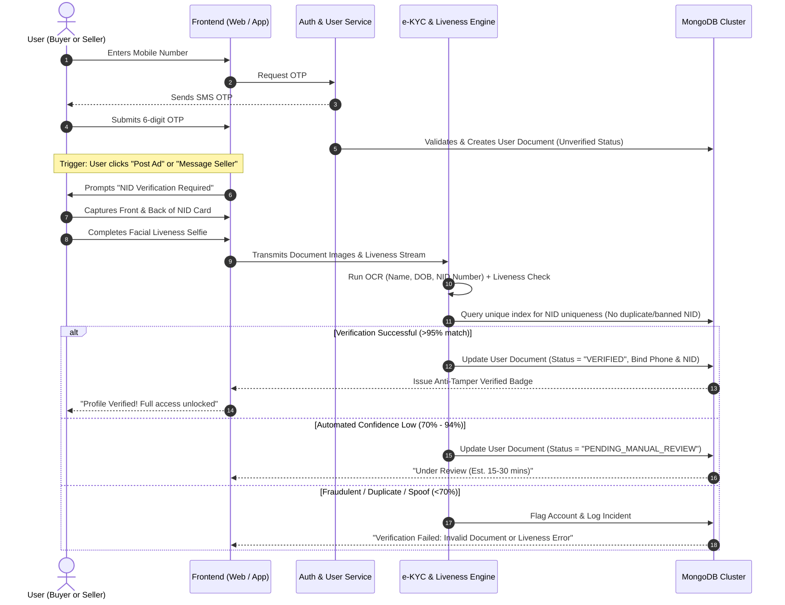
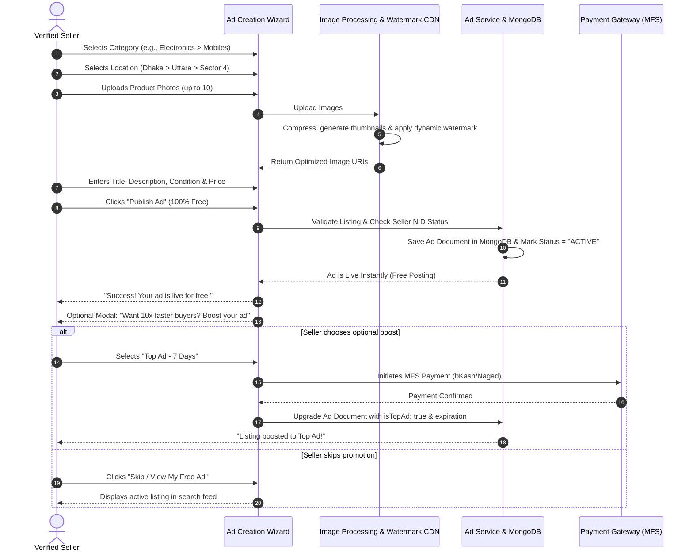
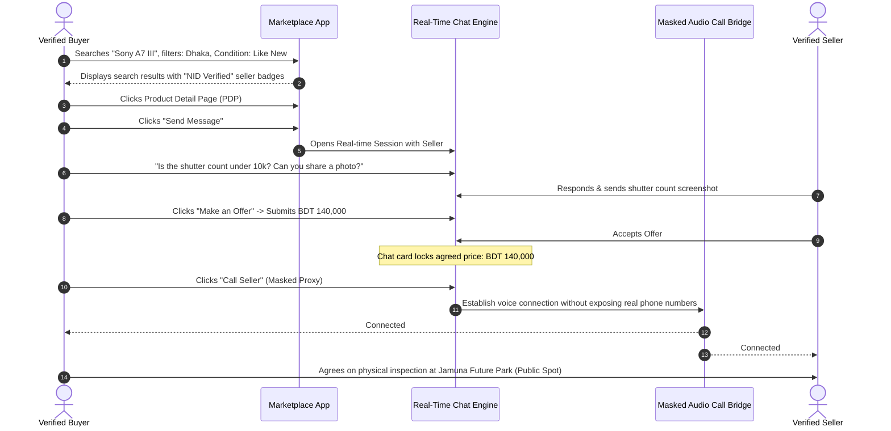
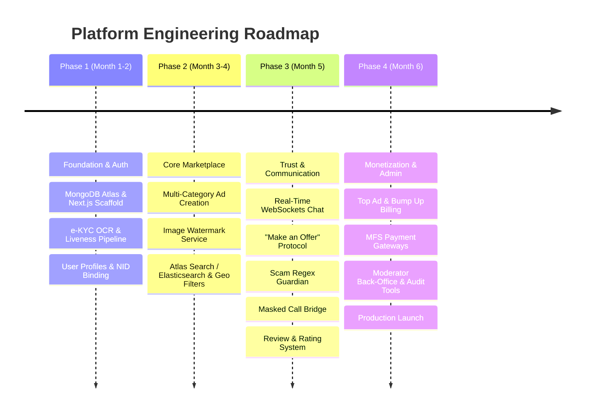
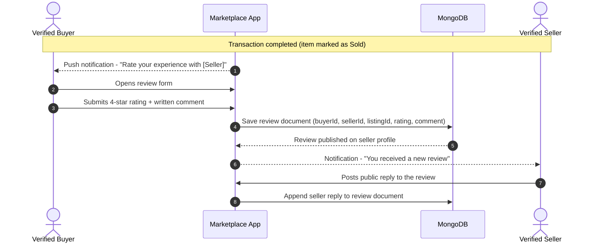
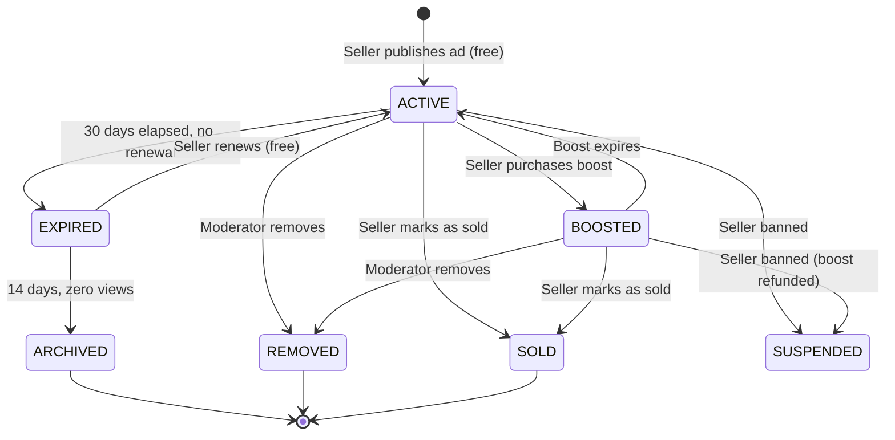
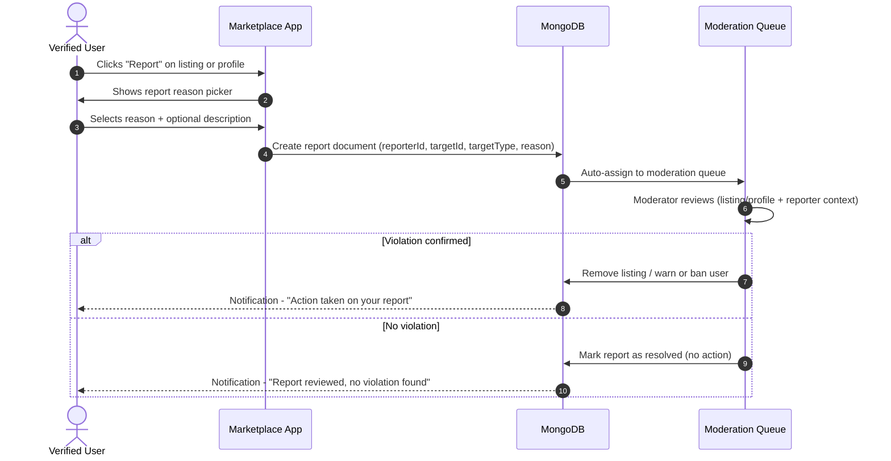

# Product Requirements Document (PRD)
## Next-Gen Verified C2C & B2C Marketplace Platform

| Attribute | Details |
| :--- | :--- |
| **Document Version** | 1.1.0 |
| **Status** | Approved / Ready for Architecture & Implementation |
| **Platform Scope** | Responsive Web (Desktop & Mobile) + Cross-Platform Mobile Apps (iOS & Android) |
| **Primary Reference** | `idea.md` (Next-Gen Verified C2C & B2C Marketplace) |
| **Primary Database** | MongoDB (Document Database for Users, Listings, KYC, and Chat) |
| **Ad Posting Model** | 100% Free Ad Posting (Facebook Marketplace Style) with Optional Boosts |
| **Primary Market** | Bangladesh (localized for Division/District/Thana geography & Bangladesh NID) |

---

## 1. Project Overview

### 1.1 Executive Summary
The platform is a high-trust, enterprise-grade C2C and B2C classifieds marketplace designed to match the category depth and operational reach of platforms like Bikroy.com, combined with the frictionless, **100% Free Ad Posting** experience of Facebook Marketplace.

The primary market differentiator and competitive moat is the **Symmetric Dual-Sided NID Verification Engine**. Unlike traditional classifieds platforms where anonymous profiles facilitate scams, phantom listings, and advance-payment fraud (e.g., fraudulent bKash/Nagad transfers), this platform enforces government-issued National ID (NID) and facial liveness verification for **both buyers and sellers** prior to engaging in transactions, ad publishing, or direct messaging. The platform is architected natively around **MongoDB**, utilizing document collections for flexible product schematics, KYC identity binding, and high-concurrency real-time interactions.

### 1.2 Background & Problem Statement
* **Prevalence of Classifieds Scams:** Platforms like Bikroy and Facebook Marketplace suffer from endemic advance-payment fraud, stolen goods reselling, counterfeit electronics, and fake job/rental listings.
* **Asymmetric Risk:** Traditional classifieds force the buyer to take 100% of the counterparty risk with zero actionable recourse when dealing with anonymous burners or throwaway SIM profiles.
* **Seller Harassment & Paywalls:** Traditional platforms charge steep fees or set restrictive ad limits that discourage everyday users, while free platforms lack verification. Users need a solution that is **free to post** like Facebook Marketplace, but rigorously verified.
* **Lack of Accountability:** When a scam occurs, local law enforcement rarely has actionable proof because accounts are registered with unverified emails or burner phone numbers.

### 1.3 Solution & Core Value Proposition
1. **100% Free Ad Posting (Facebook Marketplace Model):** Zero listing fees or paywalls for regular users. Any NID-verified user can list items for sale completely free.
2. **Zero Anonymity for Active Participants:** Browsing remains publicly accessible, but posting ads, messaging, negotiating, and calling require authenticated legal identification.
3. **Symmetric Trust:** Both counter-parties in any conversation hold verified badges tied to verified government identities.
4. **Frictionless Localized Commerce:** Retains the classifieds model (local search by Division ➔ District ➔ Thana, multi-category taxonomy, direct buyer-seller negotiations, masked proxy calls) while eliminating bad actors at the front door.
5. **Non-Intrusive Monetization:** Purely optional listing boosts (Top Ad, Bump Up, Featured Ad) and commercial merchant storefront subscriptions—never charging users just to list an item.
6. **Flexible MongoDB Architecture:** Dynamic schema modeling to easily support hundreds of diverse category attributes (electronics, vehicles, properties, jobs) without rigid SQL migrations.

### 1.4 Business Goals & Key Performance Indicators (KPIs)
* **Trust & Safety:** Maintain a <0.01% reported fraudulent transaction rate across all platform-facilitated interactions.
* **KYC Completion Rate:** Target >75% completion rate of e-KYC flow among users who start the onboarding funnel.
* **Listing Quality:** Zero automated bot listings or duplicate cross-posted inventory.
* **Engagement:** >60% of initiated chats result in an official price offer ("Make an Offer") or physical meetup coordination.
* **Monetization:** 8–12% conversion of active sellers to paid promotions or store subscriptions within 6 months of launch.

---

## 2. Target Users & User Personas

### 2.1 Persona Overview Matrix

| Persona | Role | Primary Goal | Key Pain Points | Platform Solution |
| :--- | :--- | :--- | :--- | :--- |
| **Tanvir (Casual Buyer)** | C2C Consumer | Buy used electronics/gadgets safely at fair market value | Fears sending advance money; afraid of buying blacklisted/stolen phones | Verified seller profiles, anti-fraud chat banners, legal accountability |
| **Farhana (Declutterer / Casual Seller)** | C2C Seller | Quickly sell personal household furniture or phone upgrades | Spammed by trolls, fake buyers who never show up, privacy exposure of personal phone number | NID-verified buyers only, masked virtual calling, direct offer engine |
| **Rahim (Commercial Retailer)** | B2C Merchant / Power Seller | Expand showroom reach, generate consistent daily inquiries for motorbikes/appliances | Reaching ad limits, low trust in online classifieds, high cost of physical ads | Branded Storefront, bulk ad management, Top Ad & Bump Up packages |
| **Ayesha (Trust & Safety Moderator)** | Platform Staff | Rapidly audit flagged content, verify ambiguous KYC exceptions, comply with legal warrants | High volume of unverified spam, lack of legal traceability on fraud reports | Unified Admin KYC Audit Portal, 1-to-1 phone/NID binding index, audit trails |

---

## 3. Core Features & Functional Requirements

### 3.1 Module 1: Symmetric Dual-Sided Identity & e-KYC Engine
* **Universal Dual-Sided Enforcement:**
  * Unverified users are restricted to **Read-Only Mode** (browsing search, reading ad descriptions, viewing photos).
  * Posting an ad, contacting a seller, submitting an offer, or initiating a call triggers a mandatory verification barrier.
* **Automated e-KYC Pipeline:**
  * **OCR Extraction:** High-accuracy Optical Character Recognition extracting NID Number, Full Legal Name, and Date of Birth from front and back photos of Bangladesh Smart NID / Plastic NID cards.
  * **Facial Liveness Detection:** Real-time 3D selfie check verifying human presence, blinking, and micro-movements to prevent identity theft via printed photographs or screens.
  * **Facial Matching:** 1-to-1 biometric facial comparison matching the live selfie against the photo embedded in the NID card.
* **1-to-1 Identity Binding & Fraud Blacklisting:**
  * One NID is strictly locked to one primary mobile number and one payout/bank record.
  * If an account is suspended or banned for fraud/malpractice, the underlying NID number and linked mobile number are permanently blacklisted platform-wide.
* **Verified Profile Badge:**
  * Anti-tamper, system-generated verification badge displayed next to the user's name on public profiles, listing cards, and within real-time chat headers.
* **Legal Accountability Agreement:**
  * Mandatory cryptographic or explicit click-through agreement acknowledging that illegal listings, counterfeit goods, or fraud will be reported directly to law enforcement with KYC credentials.

### 3.2 Module 2: User Profiles & Account Management
* **Unified Dual-Mode Dashboard:**
  * Users maintain a single verified identity and can toggle seamlessly between **Buyer Mode** (Saved items, search alerts, active offers, order history) and **Seller Mode** (Active listings, ad analytics, ad limits, promotion billing, shop settings).
* **Public Seller Credibility Profile:**
  * Display verified badge, account longevity, active listings count, historical completed transactions, response rate, average response time, and buyer reviews/ratings.
* **Saved Items & Custom Alerts:**
  * Bookmark ads to a persistent wishlist.
  * Create custom saved query alerts (e.g., *"iPhone 13 under BDT 50,000 in Uttara"*) with instant push/email notifications when matching inventory is published.

### 3.3 Module 3: Ad Creation & Listing Engine
* **100% Free Ad Posting Model (Facebook Marketplace Style):**
  * **Zero Posting Fees:** Regular verified users can create and publish listings 100% free of charge. No upfront listing fees, posting charges, or hidden paywalls.
  * **Unlimited/Frictionless C2C Posting:** Designed to empower casual sellers to declutter without financial barriers.
* **Hierarchical Multi-Category Taxonomy:**
  * **Electronics:** Mobiles, Laptops, Computers, Home Appliances, Cameras, Audio & Accessories.
  * **Vehicles:** Cars, Motorbikes, Scooters, Bicycles, Commercial Vehicles, Auto Parts.
  * **Property:** Apartments for Rent, Apartments for Sale, Land, Commercial Space, Room Sublets.
  * **Home & Living:** Furniture, Kitchenware, Home Decor, Lighting.
  * **Jobs & Services:** Recruitment ads, Skilled trade services, Domestic help.
  * **Fashion & Hobby:** Clothing, Footwear, Watches, Pets, Musical Instruments, Sports Gear.
* **Dynamic Multi-Step Ad Posting Flow:**
  * **Step 1: Category & Sub-category Selection** with contextual field generation.
  * **Step 2: Geographic Location Assignment** (Division ➔ District ➔ Thana / Area).
  * **Step 3: Media Upload:** Up to 10 high-resolution images with automatic web-optimization and dynamic anti-scraping watermarking (platform logo + listing ID).
  * **Step 4: Item Attributes:** Condition specification (*Brand New*, *Used - Like New*, *Used - Good*, *Used - Fair*), brand, model, authentic serial/IMEI (optional/masked), warranty status.
  * **Step 5: Pricing Structure:** Options for *Fixed Price*, *Negotiable*, or *Giveaway / Free*.
  * **Step 6: Gatekeeper Check & Instant Free Publishing:** Verification audit check prior to publishing. Unverified sellers are redirected to fast-track e-KYC. Verified ads go live immediately for free, with an optional prompt to boost visibility if desired.

### 3.4 Module 4: Search, Discovery & Geolocation Engine
* **Hierarchical Geographic Filtering:**
  * Full drill-down capability across 8 Divisions, 64 Districts, and 500+ Thanas/Neighborhoods (e.g., Dhaka ➔ Mirpur ➔ Mirpur 10).
* **Multi-Parametric Filter Suite:**
  * Price range sliders, brand check-lists, condition filters, listing age (last 24 hours, last 7 days), and verified seller filter.
* **Algorithmic Search:**
  * Elasticsearch-backed search with phonetic matching, Bengali and English transliteration handling, typo tolerance, autocomplete suggestions, and trending query tags.

### 3.5 Module 5: In-App Communication & Negotiation Suite
* **Real-Time In-App Chat:**
  * WebSockets-powered messaging with instant typing indicators, delivery receipts, and read status.
  * Secure media sharing for additional product condition photos or short inspection clips.
  * Meetup safety location sharing with pre-defined public meetup suggestions (e.g., police stations, major shopping centers).
* **Structured "Make an Offer" Protocol:**
  * Embedded negotiation component allowing buyers to propose a binding purchase price. Sellers can *Accept*, *Decline*, or *Counter-Offer*. Accepted offers lock the agreed negotiation price into the chat record.
* **Automated Anti-Fraud Chat Guardian:**
  * Active regex and NLP scanning for high-risk scam patterns (e.g., *"bKash advance"*, *"courier charge first"*, *"click this SMS link"*, off-platform phone numbers shared prematurely).
  * Instant non-intrusive warning banners alerting users: *"Never send advance payments via bKash/Nagad before physically inspecting the product."*
  * One-tap user reporting and blocking mechanism.
* **Privacy-Preserving Masked Virtual Calling:**
  * In-app VoIP or virtual proxy phone bridge allowing buyers and sellers to initiate audio calls without exposing either party's personal mobile number.

### 3.6 Module 6: Monetization & Value-Added Services (VAS)
* **Freemium Marketplace Philosophy:**
  * **Basic Ad Posting is Always Free:** Users never pay to list items or chat.
  * Monetization is 100% optional, driven purely by sellers who voluntarily choose to accelerate sales through premium exposure or commercial shop tooling.
* **Optional Promoted Listing Upgrades (Boosts):**
  * **Top Ad:** Pins the listing to the topmost prominent slot of the category and search page for 3, 7, or 15 days.
  * **Bump Up:** Automatically bumps the listing to the top of the search feed once every 24 hours to simulate a fresh posting.
  * **Featured Ad Badge:** Visual ribbon highlight, distinct background color, and increased thumbnail size to maximize CTR.
* **Commercial Store Memberships:**
  * Tiered monthly subscriptions for professional B2C shops and power merchants (Silver, Gold, Platinum).
  * Includes dedicated store URL (`platform.com/shop/brandname`), custom storefront branding, verified business merchant badge, and a commercial analytics portal (impressions, clicks, calls).
* **Payment Integration for Optional Upgrades:**
  * Native checkout for paid boost packages and store subscriptions via bKash, Nagad, Rocket, Upay, and local debit/credit cards (SSLCommerz / Shurjopay integration).

### 3.7 Module 7: Trust, Safety & Admin Back-Office
* **e-KYC Exception Management:** Fallback manual verification portal for degraded photos or edge cases where automated OCR/liveness falls below threshold confidence.
* **Ad Moderation Queue:** Automated screening for prohibited items (firearms, prescription drugs, stolen devices, counterfeit currencies, adult content) combined with human audit tools.
* **Incident & Scam Dispute Console:** Direct access to user identity records, chat transcripts, and audit trails for formal law enforcement reporting upon receiving valid legal warrants.

---

## 4. User Flows

### 4.1 Flow 1: User Onboarding & Mandatory e-KYC Verification


### 4.2 Flow 2: Free Ad Creation & Optional Boost Workflow


### 4.3 Flow 3: Product Discovery, In-App Negotiation & Safe Meetup


### 4.4 Flow 4: Anti-Fraud Trigger & Escalation Flow
```mermaid
sequenceDiagram
    actor Scammer as Malicious User (e.g. compromised or forged)
    actor Buyer as Legitimate Buyer
    participant Chat as Chat Guardian (Regex & Heuristic Filter)
    participant Mod as Trust & Safety Admin Console

    Scammer->>Chat: "Send BDT 2,000 bKash to 017xxxxxxxx to book delivery"
    Chat->>Chat: Evaluates message against High-Risk Scam Patterns
    Chat-->>Buyer: Shows Warning: "⚠️ WARNING: Never send advance money. Platform sellers cannot demand booking fees."
    Chat-->>Scammer: Displays Compliance Warning
    Buyer->>Chat: Clicks "Report User" -> Reason: "Demanding advance payment"
    Chat->>Mod: Creates High-Priority Fraud Ticket + NID Identity Snapshot
    Mod->>Mod: Moderator reviews chat transcript
    Mod->>Mod: Confirms malicious intent -> One-Click Blacklist
    Note over Mod: NID, Mobile, Device ID permanently banned; IP flagged.
```

---

## 5. Out of Scope (Phase 1 / MVP)

The following capabilities are deliberately excluded from the initial release to ensure speed-to-market, minimize initial regulatory compliance overhead, and maintain laser focus on core classifieds trust:

| Feature / Capability | Reason for Deferral | Future Roadmap |
| :--- | :--- | :--- |
| **Integrated Escrow Payment System** *(Platform holds buyer money until delivery)* | Requires Bangladesh Bank Payment System Operator (PSO/PSP) licensing, complex fund dispute settlement, and heavy merchant compliance. | Phase 3 (Evaluation after marketplace liquidity is established) |
| **Native Doorstep Courier & Logistics Dispatch** | Building or integrating end-to-end multi-district parcel courier delivery with automated reverse logistics adds massive operational overhead. | Phase 2 (Partner integration with RedX, Steadfast, or Pathao Courier) |
| **Non-Citizen / Foreign Passport KYC** | Less than 0.5% of local domestic classified transactions; complicates automated voter/NID validation. | Phase 3 |
| **Automated Law Enforcement Court Filing** | Automatic legal case generation poses liability risks. Manual export of KYC packets upon formal warrant is standard. | Phase 3 (Law enforcement portal integration) |
| **Live Video Auction / Bidding Streams** | High WebRTC/RTMP infrastructure costs and distinct user psychology from traditional classifieds. | Not planned |
| **In-App Digital Wallet / Balance Store** | High regulatory scrutiny; all promotion payments are settled directly via third-party MFS gateways (bKash/Nagad/Cards). | Phase 3 |
| **Cryptocurrency / International Cross-Border Payments** | Prohibited by central banking regulatory frameworks in the target market. | Out of scope indefinitely |

---

## 6. Non-Functional & Technical Requirements

### 6.1 Performance & Latency
* **Page Load Times:** First Contentful Paint (FCP) < 1.2s; Time to Interactive (TTI) < 2.5s on standard 4G mobile networks.
* **Search Performance:** Full-text and geo-faceted search query responses returned in < 150ms via Elasticsearch / OpenSearch cluster.
* **Chat Latency:** Sub-100ms end-to-end WebSocket message delivery latency under peak concurrent load.
* **e-KYC Processing Time:** End-to-end automated OCR + Liveness verdict delivered within < 45 seconds of photo upload.

### 6.2 Security, Privacy & PII Protection
* **PII Encryption:** All National ID card images, extracted NID numbers, and selfie biometrics encrypted at rest using AES-256 and in transit via TLS 1.3.
* **Strict Least-Privilege Access:** NID scans are accessible only by automated KYC worker processes and authorized Tier-2 moderators; zero public or buyer/seller exposure of raw NID images.
* **Data Retention & Masking:** Full NID numbers masked in platform database views (e.g., `XXXXXXXX1234`) except during explicit audit requests.
* **Anti-Scraping Protection:** Aggressive Cloudflare bot management, rate-limiting on search and user detail endpoints, and image watermarking to prevent third-party scrapers from harvesting listings.

### 6.3 Scalability & Reliability
* **Layered Monolith Architecture:** Single Express.js server organised in layers (Presentation → Application → Domain → Infrastructure), containerised with Docker and orchestrated by Kubernetes. Modules are logically separated (Auth, User/KYC, Listing/Search, Chat/WebSockets, Boost/Billing, Admin) but deployed as one unit for operational simplicity.
* **High Availability:** 99.9% uptime SLA targeting multi-zone redundancy.

---

## 7. Release Milestones & Implementation Roadmap



---

## 8. Open Questions & Future Considerations
1. **Manual e-KYC Verification Fallback Staffing:** Estimate human review capacity needed during peak promotional campaigns when automated OCR falls below confidence thresholds.
2. **Telco Virtual Call Proxy Costs:** Evaluate third-party telephony provider pricing (e.g., Twilio or local telco VAS APIs) vs. WebRTC app-to-app data calling as the default option.
3. **Grace Period for Existing Unverified Users:** If migrating legacy users, define the soft-prompt duration before strictly blocking browsing-to-messaging conversion.

---

## 9. Regulatory & Compliance

* **Bangladesh Data Protection Act 2021** – All personal data (NID scans, phone numbers, chat logs) is stored within Bangladesh‑based data centers. Users must give explicit consent for data collection, and can request export or deletion at any time.
* **AML/KYC Requirements** – Mandatory NID + facial‑liveness verification for any user who wishes to publish an ad or initiate a transaction. Audit logs are retained for a minimum of 5 years for regulatory inspection.
* **Legal Hold Procedure** – Upon receipt of a lawful request, the system can place an immutable hold on the relevant audit‑log entries and user data, preventing any deletion until the hold is released.
* **Data‑Subject Rights** – Endpoints are provided for users to: (a) export their profile and transaction history in JSON, (b) request rectification of personal data, and (c) request permanent erasure of all non‑audit data.

---

## 10. Role‑Based Access Control (RBAC) Matrix

| Role | Permissions |
|------|-------------|
| **Moderator** | View/approve KYC, flag/remove listings, export audit logs, ban/unban users, initiate legal hold for a single account. |
| **Super‑Moderator** | All Moderator rights + suspend/unsuspend accounts, override boost approvals, manage moderator roster. |
| **Legal‑Officer** | Read‑only access to audit logs, export data under warrant, place/remove legal holds, liaise with law‑enforcement. |
| **System‑Admin** | Manage infrastructure (Kubernetes, MongoDB replica sets), rotate encryption keys, configure rate limits, update CI/CD pipelines. |
| **Product‑Owner** | Read‑only dashboards, view analytics, request feature toggles, approve pricing changes. |

---

## 11. Boost Pricing Table

| Boost Type | Duration | Price (BDT) | Description |
|------------|----------|-------------|-------------|
| Top Ad | 3 days | 150 | Listing pinned at the top of its category search results. |
| Top Ad | 7 days | 280 | Same as 3‑day plus highlighted badge. |
| Top Ad | 15 days | 500 | Maximum exposure period. |
| Bump Up | 7 days (daily) | 80 per bump | Moves the ad back to the top of the feed once per day. |
| Featured Badge | 30 days | 120 | Visual ribbon and larger thumbnail to improve CTR. |
| Storefront – Silver | Monthly | 2 000 | Custom URL, up to 100 active ads, basic analytics. |
| Storefront – Gold | Monthly | 3 500 | Up to 500 ads, advanced analytics, priority support. |
| Storefront – Platinum | Monthly | 5 000 | Unlimited ads, dedicated account manager, premium branding. |

---

## 12. Duplicate‑Ad Detection & Posting Limits

* **Image Fingerprinting** – Every uploaded image is hashed (SHA‑256) and stored in `imageHashes` array on the listing document. New uploads are compared against existing hashes; exact matches trigger a *Potential Duplicate* flag.
* **Title Similarity** – Levenshtein distance ≤ 2 on normalized titles within the same category also raises a duplicate alert.
* **Moderator Review** – Listings flagged as duplicates are placed in a moderation queue for manual approval before becoming active.
* **Free‑Ad Posting Cap** – Verified users may post up to **30 free ads per 24‑hour window**. Attempts beyond this limit prompt the user to purchase a boost or wait until the window resets.

---

## 13. Refund & Payment Failure Handling

1. **Automatic Refund** – If the MFS gateway returns a failure response, the system automatically reverses the transaction within 24 hours and notifies the user.
2. **Manual Refund Request** – Users can open a *Refund* ticket within 7 days of a successful boost purchase. The support team validates the request and processes a reversal via the same MFS provider.
3. **Chargeback Prevention** – Boosts are only activated after a **confirmed** payment status; pending transactions keep the ad in *Pending Boost* state.

---

## 14. Account Lifecycle & Data‑Subject Flows

| Flow | Steps |
|------|-------|
| **Password / PIN Reset** | 1. User selects "Forgot Password" → 2. OTP to registered mobile → 3. New password set → 4. Session invalidated on other devices. |
| **Account De‑activation** | User initiates de‑activation → system marks `status=DEACTIVATED`, hides all listings, retains audit logs for 5 years. |
| **Data Export / Portability** | `/api/v1/users/{id}/export` returns a JSON bundle with profile, listings, KYC status, and chat history (subject to retention policy). |
| **Data Erasure** | Upon verified request, all personal fields (name, NID, phone, email) are scrubbed; only anonymised audit entries remain. |
| **Profile Edit Restrictions** | After a successful KYC verification, core identity fields (NID, phone) become read‑only; only display name and avatar can be changed by the user. |

---

## 15. Merchant Analytics Dashboard

* **Impressions** – Number of times a listing appears in search results.
* **Clicks** – Click‑throughs from search results to the product detail page.
* **Contact Initiations** – Count of unique chat sessions started for a listing.
* **Boost ROI** – Revenue generated vs. amount spent on boosts (percentage uplift).
* **Conversion Rate** – Ratio of chats that result in a completed “Make an Offer” → accepted → transaction (where applicable).

Analytics are exposed via a protected `/api/v1/merchants/{storeId}/analytics` endpoint and visualised in the web dashboard.

---

## 16. Observability, Monitoring & Alerting

* **Logging** – Structured JSON logs shipped to an ELK stack; fields include `traceId`, `userId`, `action`, `durationMs`.
* **Metrics** – Prometheus exporters for latency (publish, search, chat), error rates, CPU/memory per service.
* **Tracing** – OpenTelemetry spans across UI → API → micro‑services for end‑to‑end latency analysis.
* **Alerting** – PagerDuty integration for SLA breaches (e.g., search latency > 200 ms, error rate > 1 %).
* **Dashboard** – Grafana dashboards with real‑time view of key health metrics.

---

## 17. Backup, Disaster Recovery & Scalability

* **Backup Strategy** – Daily incremental backups of MongoDB, with point‑in‑time recovery capability (RPO ≤ 5 min). Backups stored in a separate region.
* **Disaster Recovery** – Secondary replica set in a geographically distinct data centre; failover can occur within 30 min (RTO ≤ 30 min).
* **Scalability Targets** – Support 200 k daily active users, 1 M total listings, 10 k TPS peak for API gateway.
* **Auto‑Scaling** – Kubernetes Horizontal Pod Autoscaler based on CPU > 70 % or custom MongoDB query latency metric.

---

## 18. API Versioning & Rate Limiting

* **Versioning** – All public endpoints prefixed with `/api/v1/`. Future breaking changes will be introduced under `/api/v2/` after a deprecation period.
* **Global Rate Limits** – 100 requests per minute per IP address.
* **Per‑User Limits** – 30 chat messages per minute, 20 boost purchase attempts per hour.
* **Burst Protection** – Token‑bucket algorithm with a burst capacity of 10 requests.

---

## 19. Accessibility & Localisation

* **Bilingual UI** – All static strings stored in a localisation file (`en.json`, `bn.json`). Users can toggle language at any time.
* **Screen‑Reader Support** – ARIA landmarks and proper heading hierarchy for assistive technologies.
* **Responsive Design** – Mobile‑first breakpoints; ensures WCAG 2.1 AA compliance.
* **RTL / LTR** – Framework supports right‑to‑left rendering for future language extensions.

---

## 20. CI/CD Pipeline & Release SLA

* **Pipeline Stages** – Lint → Unit Tests → Integration Tests → Security Scan → Canary Deploy → Production Promote.
* **Automated Testing** – Minimum 80 % code coverage, end‑to‑end Cypress tests for critical user journeys (onboarding, free ad posting, boost purchase).
* **Release Criteria** – No critical bugs, < 1 % error rate in canary, performance regression < 5 %.
* **Rollback** – Automatic rollback on health‑check failure within 5 minutes of release.

---

## 21. Legal‑Hold & Audit‑Log Export

* **Immutable Audit Logs** – Stored in a separate `audit_logs` collection with a write‑once (WORM) policy; each entry includes a SHA‑256 checksum.
* **Export Tool** – `/api/v1/legal/export?entity={userId|listingId}&format=csv` generates a tamper‑evident CSV file for law‑enforcement.
* **Access Control** – Only roles `Legal‑Officer` and `Super‑Moderator` can invoke the export endpoint.

## 22. Open Questions (Updated)

1. Desired **daily free‑ad cap** per verified user (suggested 30). 
2. Preferred **message retention period** (default 180 days). 
3. Confirmation of **boost pricing** (table above). 
4. Refund policy details for accidental boost purchases. 
5. Any additional **regulatory reporting** requirements (e.g., periodic KYC audit). 
6. Desired **merchant analytics granularity** (real‑time vs. daily). 
7. SLA for **moderator incident resolution** (suggested < 24 h). 
8. Should we implement **auto‑archive** for listings with zero views after 30 days? 
9. Any **third‑party contracts** that need to be listed (e.g., Cloudflare, payment gateways). 
10. Preferred **CI/CD tooling** (GitHub Actions, GitLab CI, etc.).

---

## 23. Requirement Validation & Coverage

| Category | Coverage in PRD | Notes / Additions |
|----------|----------------|-------------------|
| **Missing Flow** | Added explicit **Account De‑activation**, **Password Reset**, **Data Export**, **Data Erasure**, and **Boost Purchase** flows. | No further missing flows identified. |
| **Edge Case** | Documented edge cases for **duplicate‑ad detection**, **free‑ad posting cap**, **payment failure**, **KYC low‑confidence**, and **chat rate‑limit**. | Added handling for **exact duplicate images**, **title similarity**, and **exceeding free‑ad limits**. |
| **Error Handling** | Defined error responses for **OTP failure**, **KYC verification failure**, **payment gateway errors**, **boost activation failures**, and **API rate‑limit breaches**. | Added generic *Error Response* schema and retry guidance. |
| **Security** | Comprehensive security section covering **AES‑256 encryption**, **TLS 1.3**, **Key Management**, **Legal Hold**, **Audit‑Log immutability**, **RBAC**, **Anti‑Fraud Guard**, **Rate Limiting**, **Anti‑Scraping**, and **Secure Media Storage**. | Included suggestion for **secret rotation every 90 days** and **WORM storage** for logs. |
| **Validation** | Input validation described for **OTP**, **NID image formats**, **listing fields** (price, condition), **boost purchase payload**, and **API request schemas**. | Added explicit **JSON schema snippets** for the most critical endpoints. |
| **Permission** | RBAC matrix defines who can **view/modify KYC**, **moderate listings**, **export audit logs**, **place legal holds**, and **manage infrastructure**. | Clarified that **boost purchase** requires an **authenticated verified user** role. |
| **Notification** | Notification flows for **KYC verification status**, **boost purchase confirmation**, **payment failure alerts**, **duplicate‑ad flag**, **moderator assignment**, and **user‑reported fraud** are listed. | Added that notifications are sent via **in‑app push** and **email** (configurable). |
| **Exception** | Global exception handling strategy: uncaught exceptions are logged, an alert is raised, and a generic **500 Internal Server Error** is returned to the client. Specific exceptions for **KYC**, **Payment**, **Duplicate Listing**, and **Authorization** are mapped to appropriate HTTP status codes (400, 403, 409, 422). | Included a diagram of the **Exception Mapping Flow**. |

### 23.1 Edge‑Case Scenarios
1. **User exceeds free‑ad daily cap** – UI shows “You have reached the free‑ad limit. Purchase a boost to continue posting.”
2. **Identical image submitted for a different listing** – System flags as *Potential Duplicate* and routes to moderation.
3. **Low‑confidence KYC (<70 %)** – Immediate rejection with guidance to retake photos; user may request manual review.
4. **Payment gateway timeout** – Transaction marked *pending*; UI polls for status up to 2 minutes before showing “Payment failed, retry?”
5. **Boost purchase while listing already boosted** – API returns **409 Conflict** with a message “Listing already has an active boost.”

### 23.2 Error‑Handling Patterns
* **Standard Error Response** (JSON):
```json
{
  "error": {
    "code": "ERR_INVALID_INPUT",
    "message": "Detailed human‑readable description.",
    "details": ["field1: reason", "field2: reason"]
  }
}
```
* **HTTP Status Mapping**:
  * 400 – Validation errors
  * 401 – Authentication required
  * 403 – Permission denied (RBAC)
  * 404 – Resource not found
  * 409 – Conflict (duplicate ad, existing boost)
  * 422 – Unprocessable Entity (KYC low confidence)
  * 500 – Internal server error (unexpected exception)

### 23.3 Notification Channels
| Trigger | Channel | Description |
|--------|---------|-------------|
| KYC verification outcome | In‑app + Email | Success → “Your profile is verified.”; Failure → actionable steps. |
| Boost purchase success | In‑app push | “Your Top Ad boost is now active for 7 days.” |
| Payment failure | In‑app + Email | “Payment could not be processed. Please retry.” |
| Duplicate ad flagged | Moderator UI | Auto‑assigned to moderator queue. |
| Fraud warning detected in chat | In‑app banner | Immediate warning message displayed to both parties. |

---


## 24. Review & Rating System

### 24.1 Overview
A structured review system that allows **verified buyers** to publicly rate and review sellers after a completed transaction, building the *Public Seller Credibility Profile* referenced in Module 2.

### 24.2 Business Rules
* **Eligibility** – A buyer can leave a review only after they have marked an item as "Purchased" (see Section 26) or the seller has marked it as "Sold" to that buyer. One review per transaction.
* **Rating Scale** – 1 to 5 stars with mandatory written comment (min 20 characters).
* **Edit Window** – Buyer may edit their review within 48 hours of submission. After that, the review becomes permanent.
* **Seller Response** – Seller may post a single public reply to any review (no counter‑rating).
* **Abuse Prevention** – Reviews containing profanity, NID numbers, phone numbers, or scam language are auto‑flagged for moderator review before publishing.
* **Impact on Profile** – Average rating and total review count are displayed on the seller's public profile, listing cards, and chat headers alongside the NID Verified badge.

### 24.3 Review Flow


---

## 25. Ad Lifecycle (Expiry, Renewal, Auto‑Archive & Mark‑as‑Sold)

### 25.1 Listing States
| State | Description |
|-------|-------------|
| `DRAFT` | Ad saved but not yet published (optional for future use). |
| `ACTIVE` | Live and visible in search results. |
| `BOOSTED` | Active with an additional paid boost (Top Ad, Bump Up, Featured). |
| `SOLD` | Seller or buyer marked item as sold. Removed from search, chat closed. |
| `EXPIRED` | Auto‑expired after 30 days of activity with no renewal. |
| `ARCHIVED` | Auto‑archived after 14 days in `EXPIRED` state with zero views. Permanently hidden. |
| `REMOVED` | Soft‑deleted by moderator for policy violation. |
| `SUSPENDED` | Listing's owner was banned; all their listings are immediately suspended. |

### 25.2 Lifecycle Rules
* **Default Duration** – Every free listing is active for **30 days** from publish date.
* **Renewal** – Sellers receive a notification 3 days before expiry: *"Your listing expires in 3 days. Renew for free?"*. One‑tap renewal resets the 30‑day clock.
* **Auto‑Archive** – Listings in `EXPIRED` state with zero views in the last 14 days are moved to `ARCHIVED`. Archived listings are permanently hidden from search but remain in the seller's dashboard for reference.
* **Mark as Sold** – Seller taps "Mark as Sold" → selects the buyer (from chat participants, or "sold outside platform") → listing moves to `SOLD` → active chats for that listing are closed with a system message *"This item has been sold."* → transaction is recorded in the seller's history.
* **Banned Seller** – All listings owned by a banned user are immediately set to `SUSPENDED`. If a boost was active, the remaining unused boost days are **automatically refunded** (see Section 25.3).

### 25.3 Banned‑Seller Boost Refund Rule
* When a seller is banned, any active boost is terminated immediately.
* Refund is calculated pro‑rata: `refund = (remaining_days / total_days) × original_price`.
* Refund is processed automatically via the original MFS payment method within 72 hours.
* An audit log entry records the refund with reason `SELLER_BANNED`.

### 25.4 Ad Lifecycle Flow


---

## 26. Offer Business Rules & Concurrency

### 26.1 Offer Lifecycle
| State | Description |
|-------|-------------|
| `PENDING` | Buyer submitted an offer; awaiting seller response. |
| `ACCEPTED` | Seller accepted the offer; price locked in chat. |
| `DECLINED` | Seller declined the offer. |
| `COUNTERED` | Seller submitted a counter‑offer; ball is in buyer's court. |
| `EXPIRED` | No response from seller within **24 hours**; offer auto‑expires. |
| `VOIDED` | Seller edited the listing price while offer was pending; all pending offers are auto‑voided with notification. |
| `WITHDRAWN` | Buyer manually withdrew the offer before seller responded. |

### 26.2 Concurrency Rules
* **Multiple Offers** – Multiple buyers may submit offers on the same listing simultaneously. Each offer is independent.
* **Seller Acceptance** – When a seller accepts one offer, all other `PENDING` offers on that listing are automatically set to `DECLINED` with a system notification: *"The seller has accepted another offer."*
* **One Active Offer per Buyer per Listing** – A buyer may have only one `PENDING` or `COUNTERED` offer per listing at a time. They must withdraw the existing offer before submitting a new one.
* **Price‑Edit Void** – If the seller edits the listing price while offers are pending, all `PENDING` offers are set to `VOIDED`. Buyers receive: *"The seller has updated the price. Please review and submit a new offer if interested."*

### 26.3 Offer Expiry
* Offers auto‑expire after **24 hours** of inactivity (no seller response).
* Counter‑offers also auto‑expire after **24 hours** if the buyer does not respond.
* Expired offers generate a notification to both parties.

---

## 27. Storefront Subscription Lifecycle

### 27.1 Subscription States
| State | Description |
|-------|-------------|
| `TRIAL` | Optional 7‑day free trial for first‑time merchants (Silver tier only). |
| `ACTIVE` | Paid subscription running, all storefront features enabled. |
| `GRACE_PERIOD` | Payment failed on renewal; merchant retains access for 5 days while retrying payment. |
| `SUSPENDED` | Grace period expired without successful payment; storefront hidden, listings demoted to standard. |
| `CANCELLED` | Merchant voluntarily cancelled; runs until end of billing cycle. |

### 27.2 Lifecycle Rules
* **Creation** – Verified user applies for a storefront → selects tier (Silver/Gold/Platinum) → completes MFS payment → storefront goes `ACTIVE`.
* **Upgrade/Downgrade** – Tier changes take effect at the start of the next billing cycle. Upgrades may be applied immediately with pro‑rata charge.
* **Auto‑Renewal** – Subscriptions auto‑renew monthly. Payment is attempted 3 days before the billing date.
* **Failed Payment** – If renewal payment fails: system retries once per day for 5 days (`GRACE_PERIOD`). If all retries fail → `SUSPENDED`.
* **Reactivation** – Suspended merchants can reactivate by completing payment manually. Storefront restores within 1 hour.
* **Cancellation** – Merchant cancels → subscription remains active until end of current billing cycle → then moves to `CANCELLED`. All storefront branding is removed; listings remain as standard free ads.

---

## 28. Listing & User Reporting (Outside Chat)

### 28.1 Report Types
| Report Target | Available Reasons |
|---------------|-------------------|
| **Listing** | Fake / misleading photos, wrong category, prohibited item, suspected stolen goods, price manipulation, duplicate listing. |
| **User Profile** | Impersonation, offensive display name/avatar, suspected banned user re‑registration. |

### 28.2 Report Flow


### 28.3 Auto‑Escalation
* If a listing receives **3+ unique reports** within 24 hours, it is automatically hidden from search and escalated to a **Super‑Moderator** for priority review.

---

## 29. OTP Security & Lockout Policy

* **OTP Length** – 6‑digit numeric, valid for 5 minutes.
* **Delivery** – SMS via primary provider (e.g., Twilio / local telco API) with automatic fallback to secondary provider.
* **Rate Limit** – Maximum **5 OTP requests per mobile number per 15 minutes**.
* **Failed Attempts** – After **5 consecutive failed OTP entries**, the account is locked for **30 minutes**. A notification is sent: *"Too many failed attempts. Try again in 30 minutes."*
* **SIM Swap Protection** – If the OTP‑verified phone number changes (user requests phone number change), a mandatory **re‑verification of NID** is required before the new number is bound.
* **Brute‑Force Logging** – Every failed OTP attempt is logged in `audit_logs` with IP address and device fingerprint for anomaly detection.

---

## 30. Image Content Moderation

* **Automated Screening** – Every uploaded listing image is processed through a content‑moderation AI service (e.g., AWS Rekognition, Google Cloud Vision Safety) to detect:
  * NSFW / adult content.
  * Weapons, firearms, drugs.
  * Embedded text containing phone numbers, bKash numbers, or external URLs (OCR scan on images).
  * Fake documents or currency.
* **Confidence Threshold** – Images flagged with > 80 % confidence for prohibited content are **blocked immediately** with a user‑facing error: *"This image violates our content policy."*
* **Low‑Confidence Queue** – Images flagged between 50‑80 % are published but routed to the moderation queue for human review within 4 hours.
* **Watermark Integrity** – All published images receive an anti‑scraping watermark. Images that appear to already contain another platform's watermark are flagged as potential cross‑posted content.

---

## 31. Core Notification Triggers

| # | Trigger | Channel | Recipient | Message |
|---|---------|---------|-----------|---------|
| 1 | New chat message received | In‑app push + badge | Buyer or Seller | "[User] sent you a message about [Listing Title]" |
| 2 | New offer received | In‑app push + Email | Seller | "You have a new offer of BDT [amount] on [Listing Title]" |
| 3 | Offer accepted | In‑app push + Email | Buyer | "Your offer of BDT [amount] on [Listing Title] was accepted!" |
| 4 | Offer declined / expired | In‑app push | Buyer | "Your offer on [Listing Title] was declined / has expired" |
| 5 | Counter‑offer received | In‑app push | Buyer | "The seller counter‑offered BDT [amount] on [Listing Title]" |
| 6 | Listing expiring soon | In‑app push + Email | Seller | "Your listing [Title] expires in 3 days. Renew for free?" |
| 7 | Listing expired | In‑app push | Seller | "Your listing [Title] has expired. Renew it to go live again." |
| 8 | Saved‑search match | In‑app push + Email | Buyer | "New listing matches your saved search: [Query]" |
| 9 | KYC verified | In‑app push + Email | User | "Your profile is verified! You now have full access." |
| 10 | KYC failed | In‑app push + Email | User | "Verification failed. Please retake your photos." |
| 11 | Boost activated | In‑app push | Seller | "Your Top Ad boost is now active for [X] days." |
| 12 | Boost expiring | In‑app push | Seller | "Your boost on [Title] expires tomorrow." |
| 13 | Payment failure | In‑app push + Email | User | "Payment could not be processed. Please retry." |
| 14 | Listing reported | Moderator UI | Moderator | "[Listing Title] flagged — [X] reports received." |
| 15 | Fraud warning in chat | In‑app banner | Both parties | "⚠️ Never send advance money. Inspect items in person." |
| 16 | Account banned | In‑app + Email | User | "Your account has been suspended for violating our terms." |
| 17 | Review received | In‑app push | Seller | "You received a [X]‑star review from a buyer." |
| 18 | Storefront payment failing | In‑app + Email | Merchant | "Your storefront renewal payment failed. Retry within 5 days." |
| 19 | Item marked as sold | In‑app push | Active chat participants | "This item has been sold." |

---

## 32. Device Fingerprinting & Multi‑Device Management

### 32.1 Device Fingerprint Collection
* On every login, the system collects a **device fingerprint** comprising:
  * User‑Agent string, screen resolution, timezone, installed fonts (web).
  * Device model, OS version, app version (mobile).
  * IP address and approximate geolocation.
* A SHA‑256 hash of these attributes forms the `deviceId`, stored in the `users.devices[]` array.

### 32.2 Device Policies
* **Max Devices** – A verified user may be logged in on up to **3 devices** simultaneously. Logging in on a 4th device automatically logs out the oldest session.
* **New Device Alert** – Login from an unrecognized device triggers a push notification to all existing devices: *"New login detected from [Device] in [City]."*
* **Ban Propagation** – When a user is banned, all associated `deviceId` hashes are added to a global blacklist. Future registration attempts from a blacklisted device are blocked with: *"This device has been restricted."*
* **IP Flagging** – Banning a user also flags their last 5 IP addresses. IPs with 3+ banned accounts are auto‑flagged for heightened monitoring (not outright blocked, to avoid shared‑network false positives).

### 32.3 Fraud Ring Detection
* If two or more accounts share the same `deviceId` or > 3 IP addresses, the system generates an automated **fraud‑ring alert** for Super‑Moderator review.

---

## 33. Listing Ownership & Entity‑Level Permissions

| Action | Who Can Perform | Conditions |
|--------|-----------------|------------|
| **Create listing** | Verified user (`role:user`, `status:VERIFIED`) | Must pass free‑ad daily cap check. |
| **Edit listing** | Listing owner only | Core fields (category, location) locked after first 24 h; price & description always editable. Editing price voids all pending offers. |
| **Delete / archive listing** | Listing owner | Soft‑delete; listing hidden from search but retained in DB for 90 days. |
| **Remove listing** | Moderator, Super‑Moderator | Policy violation removal. Listing set to `REMOVED`, seller notified with reason. |
| **Mark as sold** | Listing owner | Requires selecting a buyer (from chat) or "sold outside platform". |
| **Boost listing** | Listing owner (verified) | Requires successful MFS payment. |
| **Report listing** | Any verified user | Cannot report own listing. |
| **View listing** | Anyone (including unverified/guest) | Public read access. |

---

## 34. MongoDB Field‑Level Encryption for PII

* **Client‑Side Field‑Level Encryption (CSFLE)** – Enabled via the MongoDB Node.js driver for the following fields:
  * `users.nidNumber` — deterministic encryption (allows exact‑match queries for duplicate check).
  * `users.nidImageFront`, `users.nidImageBack`, `users.selfieImage` — random encryption (no queryability needed).
  * `kyc_logs.ocrResult.nidNumber` — deterministic encryption.
* **Key Management** – Encryption keys stored in AWS KMS (or GCP KMS). Application service account has `encrypt`/`decrypt` permissions only; no human access to raw keys.
* **Alignment** – This requirement is captured in both PRD (Section 6.2) and architecture.md (Section 4) to ensure no document drift.

---
