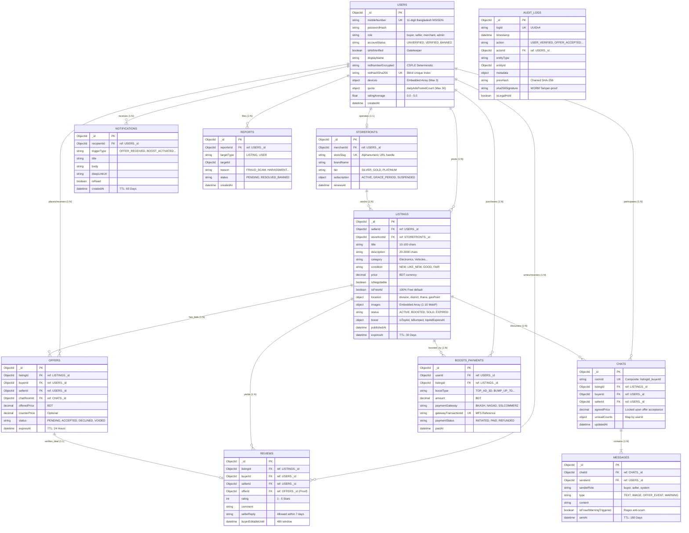

# Database Specification & Modeling Architecture (`database.md`)
## Next-Gen Verified C2C & B2C Marketplace Platform (Bangladesh)

| Document Attribute | Specification |
| :--- | :--- |
| **Document Version** | 2.0.0 (Production Master) |
| **Database Engine** | MongoDB Atlas (Enterprise Managed Replica Set, 1 Primary + 2 Secondaries, M10+ Tier) |
| **ODM / Driver** | Mongoose v8+ with TypeScript / Native MongoDB Node.js Driver v6+ |
| **Encryption Standard** | Client-Side Field Level Encryption (CSFLE / In-Use Encryption with AWS/GCP KMS) |
| **Primary Reference Documents** | `PRD.md` (v1.1.0+), `architecture.md` (v2.0.0), `dfd.md` (v1.0.1), `schema-database.md` (v1.0.0), `erd.md` (v1.0.0) |
| **Sharding Key Strategy** | Hashed Sharding on `{ division: 1, _id: 1 }` (Ready for 10M+ listings scaling) |
| **Transaction Guarantee** | Multi-Document Distributed ACID Transactions (`readConcern: "majority"`, `writeConcern: "majority"`) |

---

## 1. Collection List

The database schema is decoupled into 11 distinct collections mapped from the Data Flow Diagram (`dfd.md`) data stores (`D1` through `D9`) and trust/safety requirements.

| # | Collection Name | DFD Store | Domain / Module | Sharding / Partition Key | Estimated Scale (Year 1) | Data Retention & Purge Policy |
| :--- | :--- | :--- | :--- | :--- | :--- | :--- |
| **1** | `users` | `D1` | Identity, Auth & KYC | `{ _id: "hashed" }` | 500,000 documents | Active Account Lifetime + 5 Years (Regulatory KYC compliance retention) |
| **2** | `listings` | `D2` | Classifieds Catalog | `{ division: 1, _id: 1 }` | 2,000,000 documents | 30 Days Active TTL Index; Soft-deleted records retained 90 days before purge |
| **3** | `offers` | `D3` | Negotiation Engine | `{ listingId: 1, _id: 1 }` | 1,500,000 documents | 24 Hours TTL on unaccepted pending offers; 180 days completed deal history |
| **4** | `chats` | `D4` | Real-Time Messaging | `{ roomId: 1 }` | 1,000,000 rooms | 180 Days rolling storage; user-erasure / GDPR-style compliant |
| **5** | `messages` | `D4` | Message Streams | `{ roomId: 1, _id: 1 }` | 25,000,000 messages | 180 Days TTL Index on `sentAt` |
| **6** | `reviews` | `D5` | Trust & Reputation | `{ sellerId: 1, _id: 1 }` | 300,000 documents | Permanent / Immutable post-48h edit window; audit-linked |
| **7** | `storefronts` | `D6` | B2C Merchant Spaces | `{ storeSlug: 1 }` | 15,000 merchants | Subscription Lifetime + 1 Year archive |
| **8** | `boosts_payments` | `D7` | Monetization & MFS | `{ _id: "hashed" }` | 400,000 transactions | 7 Years Immutable (Bangladesh Financial & Tax Compliance) |
| **9** | `audit_logs` | `D8` | WORM Compliance Trail | `{ timestamp: 1, _id: 1 }` | 50,000,000 events | Minimum 5 Years Immutable WORM append-only log with SHA-256 chaining |
| **10** | `notifications` | `D9` | Push & In-App Alerts | `{ recipientId: 1, _id: 1 }` | 10,000,000 alerts | 60 Days TTL auto-purge on read/dismissed alerts |
| **11** | `reports` | `P-7.0` | Abuse & Fraud Queue | `{ targetId: 1, _id: 1 }` | 100,000 tickets | 3 Years post-moderation resolution |

---

## 2. Schema (Detailed Data Modeling & Fields)

### 2.1 Collection: `users` (`D1`)
Represents registered platform actors (Buyers, Sellers, Merchants, Admins, Moderators, and Legal Officers).

```typescript
interface IUserDevice {
  deviceId: string;          // Hardware client fingerprint SHA-256
  deviceName: string;        // e.g., "Samsung Galaxy S23", "Chrome on macOS"
  platform: 'web_desktop' | 'web_mobile' | 'android_native' | 'ios_native';
  fcmToken?: string;         // Firebase Cloud Messaging push token
  ipAddress: string;         // Client IP address
  lastActiveAt: Date;
}

interface IUserKYC {
  nidNumberEncrypted?: string;    // CSFLE Deterministic AES-256-CBC
  nidHashSha256?: string;         // Indexed blind-index hash for uniqueness check
  nidType?: 'SMART' | 'PLASTIC';  // Supports both Smart NID and Old Plastic Laminated NID
  dob?: Date;
  extractedLegalName?: string;
  livenessConfidenceScore?: number; // 0 to 100
  nidFrontImageUrl?: string;      // S3/R2 encrypted private bucket path
  nidBackImageUrl?: string;
  selfieVideoUrl?: string;
  verifiedAt?: Date;
  manualVerifiedBy?: ObjectId;    // Reference to Admin/Moderator if routed to manual queue
  rejectionReason?: string;       // Recorded if e-KYC is rejected
}

interface IUserQuota {
  dailyAdsPostedCount: number;    // Counter: Max 30 free ads per 24-hour rolling window
  quotaWindowStartsAt: Date;      // Timestamp when current 24-hour window commenced
}

interface IUserPrivacySettings {
  isPhoneVisible: boolean;        // Default: false (Privacy-first; masked calling preferred)
  allowProxyCalls: boolean;       // Default: true (Enables virtual telephony bridge)
}

interface IUser {
  _id: ObjectId;
  mobileNumber: string;           // Unique 11-digit Bangladesh MSISDN (^01[3-9]\d{8}$)
  passwordHash: string;           // Argon2id / bcrypt salted hash
  role: 'buyer' | 'seller' | 'merchant' | 'moderator' | 'admin' | 'legal_officer';
  accountStatus: 'UNVERIFIED' | 'VERIFIED' | 'SUSPENDED' | 'BANNED';
  isNidVerified: boolean;         // Gatekeeper for ad creation & buyer contact
  displayName: string;
  avatarUrl?: string;
  location?: {
    division: string;
    district: string;
    thana: string;
    addressLine?: string;
  };
  kyc: IUserKYC;
  devices: IUserDevice[];         // Max 3 concurrent device bindings
  authLockout: {
    failedOtpAttempts: number;    // Counter reset on success
    lockoutUntil?: Date;          // 30 min lockout triggered at 5 failed attempts
  };
  quota: IUserQuota;              // Enforces 30 free ads / 24h invariant
  privacySettings: IUserPrivacySettings;
  stats: {
    ratingAverage: number;        // Float 0.0 to 5.0
    ratingCount: number;          // Total verified buyer reviews
    totalListingsCreated: number;
    activeListingsCount: number;
    totalDealsCompleted: number;
    responseRatePercent: number;  // Chat response timeliness metric
  };
  createdAt: Date;
  updatedAt: Date;
}
```

### 2.2 Collection: `listings` (`D2`)
Represents 100% free ad classifieds and optional boosted promotions.

```typescript
interface IListingImage {
  originalUrl: string;
  watermarkedUrl: string;       // Anti-scraping branded WebP
  thumbnailUrl: string;         // 200x200 optimized card view
  pHash: string;                // Perceptual image hash to detect duplicate ad spam
  isNsfwSafe: boolean;
  moderationScore: number;
}

interface IListingBoost {
  isTopAd: boolean;
  topAdExpiresAt?: Date;
  isBumped: boolean;
  lastBumpedAt?: Date;
  isFeatured: boolean;
  featuredExpiresAt?: Date;
  activeBoostId?: ObjectId;     // Reference to boosts_payments
}

interface IListingSoftDelete {
  isDeleted: boolean;
  deletedAt?: Date;
  deletedBy?: ObjectId;
  deletionReason?: string;
}

interface IListing {
  _id: ObjectId;
  sellerId: ObjectId;           // Reference to users._id
  storefrontId?: ObjectId;      // Optional reference to storefronts._id (B2C)
  title: string;                // 10 to 100 characters sanitized text
  description: string;          // 20 to 2000 characters
  category: 'Electronics' | 'Vehicles' | 'Property' | 'Home_Living' | 'Jobs_Services' | 'Fashion_Hobby';
  subCategory: string;
  attributes: Map<string, any>; // Dynamic specs (e.g. ram: "8GB", mileage: "25000km")
  condition: 'NEW' | 'LIKE_NEW' | 'GOOD' | 'FAIR';
  price: number;                // Currency: BDT, positive decimal
  isNegotiable: boolean;
  isFreeAd: boolean;            // Invariant: true by default (100% free ad model)
  location: {
    division: string;
    district: string;
    thana: string;
    geoPoint?: {
      type: 'Point';
      coordinates: [number, number]; // [longitude, latitude]
    };
  };
  images: IListingImage[];      // Min 1, Max 10 images
  status: 'ACTIVE' | 'BOOSTED' | 'SOLD' | 'EXPIRED' | 'ARCHIVED' | 'SUSPENDED';
  viewCount: number;
  favoriteCount: number;
  chatInitiationCount: number;
  boost: IListingBoost;
  softDelete: IListingSoftDelete; // 90-day retention prior to permanent purge
  publishedAt: Date;
  expiresAt: Date;              // TTL Auto-expiry (publishedAt + 30 days)
  soldAt?: Date;
  renewedAt?: Date;
  createdAt: Date;
  updatedAt: Date;
}
```

### 2.3 Collection: `offers` (`D3`)
Represents formal, binding purchase bids placed by buyers inside the negotiation channel.

```typescript
interface IOffer {
  _id: ObjectId;
  listingId: ObjectId;          // Reference to listings._id
  buyerId: ObjectId;            // Reference to users._id
  sellerId: ObjectId;           // Reference to users._id
  chatRoomId: ObjectId;         // Reference to chats._id
  offeredPrice: number;         // BDT price proposal <= listing price
  counterPrice?: number;        // Counter-bid price proposed by seller
  status: 'PENDING' | 'ACCEPTED' | 'DECLINED' | 'COUNTERED' | 'EXPIRED' | 'VOIDED' | 'WITHDRAWN';
  message?: string;             // Optional buyer note (max 200 chars)
  expiresAt: Date;              // 24-hour expiration window
  acceptedAt?: Date;
  closedAt?: Date;
  createdAt: Date;
  updatedAt: Date;
}
```

### 2.4 Collection: `chats` & `messages` (`D4`)
Separated into room aggregates (`chats`) and high-volume message packets (`messages`).

```typescript
interface ITelephonyBridgeLog {
  callSessionId: string;
  initiatedBy: ObjectId;
  startedAt: Date;
  durationSeconds: number;
  callStatus: 'COMPLETED' | 'MISSED' | 'FAILED';
}

interface IChat {
  _id: ObjectId;
  roomId: string;               // Unique composite: `${listingId}_${buyerId}`
  listingId: ObjectId;          // Reference to listings._id
  sellerId: ObjectId;           // Reference to users._id
  buyerId: ObjectId;            // Reference to users._id
  participants: ObjectId[];     // [buyerId, sellerId]
  lastMessage?: {
    senderId: ObjectId;
    content: string;
    type: 'TEXT' | 'IMAGE' | 'OFFER' | 'MEETUP_PIN' | 'SYSTEM';
    sentAt: Date;
  };
  unreadCounts: {
    [userId: string]: number;   // Keyed by ObjectId string
  };
  activeOfferId?: ObjectId;     // Current pending or accepted offer reference
  agreedPrice?: number;         // Set when offer accepted
  telephonyLogs: ITelephonyBridgeLog[]; // Masked proxy call history
  isArchivedBy: ObjectId[];     // Soft archive toggles
  isBlocked: boolean;
  blockedBy?: ObjectId;
  createdAt: Date;
  updatedAt: Date;
}

interface IMessage {
  _id: ObjectId;
  chatId: ObjectId;             // Reference to chats._id
  roomId: string;               // Redundant partition key for fast lookup
  senderId: ObjectId;           // Reference to users._id
  senderRole: 'buyer' | 'seller' | 'system';
  type: 'TEXT' | 'IMAGE' | 'OFFER_EVENT' | 'MEETUP_PIN' | 'SYSTEM_WARNING';
  content: string;              // Text payload or system notice
  mediaUrl?: string;            // Cloudflare R2 media path
  geoPin?: {
    title: string;
    coordinates: [number, number]; // Proposed safe public exchange point
  };
  isFraudWarningTriggered: boolean; // Triggered by regex (e.g. bKash advance scam)
  readAt?: Date;
  sentAt: Date;
}
```

### 2.5 Collection: `reviews` (`D5`)
Represents post-transaction ratings enforcing a dual-party feedback loop.

```typescript
interface IReview {
  _id: ObjectId;
  listingId: ObjectId;          // Reference to listings._id
  buyerId: ObjectId;            // Reference to users._id (Reviewer)
  sellerId: ObjectId;           // Reference to users._id (Reviewee)
  offerId: ObjectId;            // Verifiable proof of deal completion (Reference to offers._id)
  rating: number;               // Integer 1 to 5
  comment: string;              // 10 to 500 characters
  sellerReply?: {
    comment: string;
    repliedAt: Date;            // Allowed only within 7 days of review creation
  };
  isReported: boolean;
  moderationStatus: 'APPROVED' | 'FLAGGED' | 'REMOVED';
  buyerEditableUntil: Date;     // 48-hour post-creation edit window
  createdAt: Date;
  updatedAt: Date;
}
```

### 2.6 Collection: `storefronts` (`D6`)
Represents verified commercial B2C merchant profiles.

```typescript
interface IStorefront {
  _id: ObjectId;
  merchantId: ObjectId;         // Unique 1:1 reference to users._id
  storeSlug: string;            // Unique alphanumeric URL handle (e.g., "gadget-bd")
  brandName: string;
  tagline?: string;
  description: string;
  logoUrl: string;
  bannerUrl: string;
  tradeLicenseNumber?: string;  // Commercial business compliance field
  tier: 'SILVER' | 'GOLD' | 'PLATINUM';
  contact: {
    officialPhone: string;
    officialEmail: string;
    physicalStoreAddress: string;
    websiteUrl?: string;
  };
  subscription: {
    status: 'TRIAL' | 'ACTIVE' | 'GRACE_PERIOD' | 'SUSPENDED' | 'CANCELLED';
    planId: string;
    renewsAt: Date;
    gracePeriodEndsAt?: Date;   // 5 days grace period on payment failure
    lastPaidInvoiceId?: ObjectId;
  };
  metrics: {
    totalListings: number;
    totalStorefrontViews: number;
    followerCount: number;
  };
  createdAt: Date;
  updatedAt: Date;
}
```

### 2.7 Collection: `boosts_payments` (`D7`)
Financial transactions collection tracking ad promotions and merchant subscriptions via MFS.

```typescript
interface IBoostPayment {
  _id: ObjectId;
  userId: ObjectId;             // Buyer/Seller/Merchant making payment
  entityType: 'LISTING_BOOST' | 'MERCHANT_SUBSCRIPTION';
  listingId?: ObjectId;         // Populated if entityType === 'LISTING_BOOST'
  storefrontId?: ObjectId;      // Populated if entityType === 'MERCHANT_SUBSCRIPTION'
  boostType?: 'TOP_AD_3D' | 'TOP_AD_7D' | 'TOP_AD_15D' | 'BUMP_UP_7D' | 'FEATURED_30D';
  amount: number;               // In BDT decimal
  currency: 'BDT';
  paymentGateway: 'BKASH' | 'NAGAD' | 'ROCKET' | 'SSLCOMMERZ';
  gatewayTransactionId?: string; // MFS reference (e.g., "9K38DF781A")
  clientIp: string;
  paymentStatus: 'INITIATED' | 'PENDING' | 'PAID' | 'FAILED' | 'CANCELLED' | 'REFUNDED';
  gatewayPayload?: Record<string, any>; // Raw webhook verification response
  signature: string;            // HMAC-SHA256 callback integrity signature
  paidAt?: Date;
  refundMetadata?: {
    refundedAt: Date;
    refundReason: string;
    proRataAmount: number;
  };
  createdAt: Date;
  updatedAt: Date;
}
```

### 2.8 Collection: `audit_logs` (`D8` - WORM Storage)
Cryptographically signed compliance audit logs. Write-Once, Read-Many (WORM).

```typescript
interface IAuditLog {
  _id: ObjectId;
  logId: string;                // UUIDv4
  timestamp: Date;              // ISO-8601 UTC
  action: 'USER_REGISTERED' | 'USER_VERIFIED' | 'USER_BANNED' | 'LISTING_CREATED' | 
          'LISTING_BANNED' | 'OFFER_ACCEPTED' | 'BOOST_PURCHASED' | 
          'LEGAL_HOLD_APPLIED' | 'WARRANT_DATA_EXPORTED';
  actorId: ObjectId;            // Reference to users._id or SYSTEM ObjectId
  actorRole: string;
  actorIp: string;
  entityType: 'USER' | 'LISTING' | 'OFFER' | 'PAYMENT' | 'KYC_RECORD';
  entityId: ObjectId;
  metadata: Record<string, any>;// Full snapshot of modified attributes
  prevHash: string;             // SHA-256 of preceding log entry
  sha256Signature: string;      // SHA-256(prevHash + logId + timestamp + action + metadata)
  isLegalHold: boolean;         // Prevents purging under legal warrant
}
```

### 2.9 Collection: `notifications` (`D9`)
Asynchronous multi-channel user alerts queue.

```typescript
interface INotification {
  _id: ObjectId;
  recipientId: ObjectId;        // Reference to users._id
  triggerType: 'OFFER_RECEIVED' | 'OFFER_ACCEPTED' | 'OFFER_DECLINED' | 
               'KYC_APPROVED' | 'KYC_REJECTED' | 'BOOST_ACTIVATED' | 
               'AD_EXPIRING_SOON' | 'AD_EXPIRED' | 'NEW_REVIEW' | 'SCAM_WARNING';
  title: string;
  body: string;
  deepLinkUri: string;          // e.g. "/listings/66c4f8a.../offers"
  isRead: boolean;
  readAt?: Date;
  channelDispatched: {
    inApp: boolean;
    fcmPush: boolean;
    smsFallback: boolean;
  };
  createdAt: Date;              // TTL Index 60 days
}
```

### 2.10 Collection: `reports`
Abuse tickets filed by users against listings or accounts.

```typescript
interface IReport {
  _id: ObjectId;
  reporterId: ObjectId;         // Reference to users._id
  targetType: 'LISTING' | 'USER';
  targetId: ObjectId;
  reason: 'FRAUD_SCAM' | 'OFFENSIVE_CONTENT' | 'DUPLICATE_SPAM' | 'PROHIBITED_GOODS' | 'HARASSMENT';
  description?: string;
  evidenceRoomId?: string;      // Reference to chat room if scam occurred in chat
  status: 'PENDING' | 'UNDER_REVIEW' | 'RESOLVED_BANNED' | 'DISMISSED';
  resolvedBy?: ObjectId;        // Moderator ID
  resolutionNotes?: string;
  createdAt: Date;
  updatedAt: Date;
}
```

---

## 3. Relationship (Data Modeling Paradigms)

MongoDB is a document-oriented database. We apply the **Embedding vs. Referencing Hybrid Strategy** based on write contention, document growth bounds, and access patterns:

```
[users] 1 ──── 0..1 [storefronts] (1:1 Merchant Profile - Referenced)
   │
   ├──── 1:N ──── [devices] (1:N Max 3 - Embedded inside users.devices)
   ├──── 1:N ──── [listings] (1:N Catalog Ads - Referenced)
   ├──── 1:N ──── [offers] (1:N Proposals - Referenced)
   ├──── 1:N ──── [chats] (1:N Communication Rooms - Referenced)
   ├──── 1:N ──── [reviews] (1:N Verified Transaction Ratings - Referenced)
   └──── 1:N ──── [notifications] (1:N Alerts - Referenced with TTL)

[listings] 1 ──── 1:N ──── [images] (1:N Max 10 - Embedded inside listings.images)
[listings] 1 ──── 1:N ──── [offers] (1:N Offers on Item - Referenced)
[listings] 1 ──── 1:N ──── [boosts_payments] (1:N Boost Ledger - Referenced)

[chats] 1 ──── 1:N ──── [messages] (1:N Message Stream - Referenced in separated collection)
```

### 3.1 Why Embedding?
1. **`users.devices`:** A user has at most 3 concurrent active devices. Array length is strictly bounded (O(1)). Embedding prevents an extra `$lookup` query during every authenticated API request.
2. **`listings.images`:** An ad has between 1 and 10 images. Document growth is bounded and images are always fetched together when rendering listing cards or details pages.
3. **`listings.boost`:** Current promotion state (`isTopAd`, `topAdExpiresAt`) is embedded directly on the listing document so that query sort criteria (`{ "boost.isTopAd": -1, publishedAt: -1 }`) execute without relational joins.

### 3.2 Why Referencing?
1. **`messages` in a separate collection from `chats`:** High-velocity messaging would hit the 16MB document limit if embedded in a single chat room document. Separating messages allows pagination (`limit(50).skip(...)`) and fine-grained 180-day TTL purging.
2. **`offers` referencing `listings` and `users`:** Multiple buyers submit bids on one listing. Concurrent atomic state updates (accepting one offer while voiding competing ones) requires isolated documents for ACID transaction isolation.
3. **`reviews` referencing `users` and `offers`:** Reviews require an independent moderation lifecycle, seller reply windows, and verifiable reference to the completed transaction offer.

---

## 4. Index Strategy

Indexes are engineered to satisfy sub-150ms search latency, geographic drilldowns, security throttling, and automatic record expiration.

| Collection | Index Key Definition | Index Type | Purpose / Query Optimization |
| :--- | :--- | :--- | :--- |
| **`users`** | `{ mobileNumber: 1 }` | Unique B-Tree | Primary login / OTP lookup |
| **`users`** | `{ "kyc.nidHashSha256": 1 }` | Unique Sparse | 1-to-1 NID binding; rejects duplicate NID reuse |
| **`users`** | `{ "devices.deviceId": 1 }` | Standard B-Tree | Device hardware fraud-ring trace & blacklisting |
| **`users`** | `{ accountStatus: 1, isNidVerified: 1 }` | Compound | Fast permission & gating checks |
| **`users`** | `{ "quota.quotaWindowStartsAt": 1 }` | Standard B-Tree | Resetting 24h rolling free ad quota counter |
| **`listings`** | `{ "boost.isTopAd": -1, publishedAt: -1 }` | Compound | Default catalog feed sorting (Top Ads first) |
| **`listings`** | `{ division: 1, district: 1, thana: 1, category: 1, status: 1 }` | Compound Filter | High-frequency geographic drilldown queries |
| **`listings`** | `{ "location.geoPoint": "2dsphere" }` | Geospatial | "Ads near me" radius search (within 5km / 10km) |
| **`listings`** | `{ title: "text", description: "text" }` | Text Index (Weights: title=10, desc=1) | Keyword search across titles & descriptions |
| **`listings`** | `{ expiresAt: 1 }` | **TTL Index (`expireAfterSeconds: 0`)** | Auto-transitions expired ads after 30 days |
| **`listings`** | `{ status: 1, "softDelete.isDeleted": 1 }` | Compound Partial | Fast queries excluding soft-deleted ads |
| **`listings`** | `{ sellerId: 1, createdAt: -1 }` | Compound | Seller profile catalog & daily 30-ad quota count |
| **`offers`** | `{ listingId: 1, buyerId: 1 }` | Compound | Single-active-offer invariant verification |
| **`offers`** | `{ expiresAt: 1 }` | **TTL Index (`expireAfterSeconds: 0`)** | Auto-purges/expires unaccepted offers after 24h |
| **`offers`** | `{ sellerId: 1, status: 1 }` | Compound | Seller negotiation inbox count |
| **`chats`** | `{ roomId: 1 }` | Unique B-Tree | O(1) instant chat session retrieval |
| **`chats`** | `{ participants: 1, updatedAt: -1 }` | Compound Multikey | User inbox list sorted by most recent message |
| **`messages`**| `{ chatId: 1, sentAt: -1 }` | Compound Reverse | Reverse-chronological message stream pagination |
| **`messages`**| `{ sentAt: 1 }` | **TTL Index (`expireAfterSeconds: 15552000`)** | 180-Day automatic rolling message retention |
| **`reviews`** | `{ sellerId: 1, createdAt: -1 }` | Compound | Public seller feedback stream & score calculation |
| **`reviews`** | `{ listingId: 1, buyerId: 1 }` | Unique Compound | Enforces 1 review per transaction invariant |
| **`storefronts`**| `{ storeSlug: 1 }` | Unique B-Tree | Clean vanity URL routing (`/store/gadget-bd`) |
| **`storefronts`**| `{ merchantId: 1 }` | Unique B-Tree | 1 Storefront per merchant binding |
| **`boosts_payments`**| `{ gatewayTransactionId: 1 }` | Unique Sparse | Prevents replay attacks and double-crediting |
| **`boosts_payments`**| `{ listingId: 1, paymentStatus: 1 }` | Compound | Verification of active paid boosts |
| **`audit_logs`**| `{ timestamp: -1, action: 1 }` | Compound | Chronological legal audit queries |
| **`audit_logs`**| `{ actorId: 1, timestamp: -1 }` | Compound | Forensic tracking of actor activity |
| **`notifications`**| `{ recipientId: 1, isRead: 1, createdAt: -1 }` | Compound | In-app unread notification count badge |
| **`notifications`**| `{ createdAt: 1 }` | **TTL Index (`expireAfterSeconds: 5184000`)** | 60-Day auto-purge of old notifications |
| **`reports`** | `{ targetId: 1, status: 1 }` | Compound | Aggregating report count to trigger auto-escalation |

---

## 5. Validation (`$jsonSchema` Enforcement)

MongoDB Atlas enforces schema invariants at the database engine level via JSON Schema validation. This prevents malformed documents even if an application bug bypasses API DTO validations.

### 5.1 JSON Schema Validator: `listings` Collection

```javascript
db.createCollection("listings", {
  validator: {
    $jsonSchema: {
      bsonType: "object",
      required: ["sellerId", "title", "description", "category", "condition", "price", "location", "status", "publishedAt", "expiresAt"],
      properties: {
        sellerId: {
          bsonType: "objectId",
          description: "Must reference an existing user ObjectId"
        },
        title: {
          bsonType: "string",
          minLength: 10,
          maxLength: 100,
          description: "Listing title must be 10-100 characters"
        },
        description: {
          bsonType: "string",
          minLength: 20,
          maxLength: 2000,
          description: "Description must be 20-2000 characters"
        },
        category: {
          enum: ["Electronics", "Vehicles", "Property", "Home_Living", "Jobs_Services", "Fashion_Hobby"],
          description: "Must be a valid platform category"
        },
        condition: {
          enum: ["NEW", "LIKE_NEW", "GOOD", "FAIR"],
          description: "Must be a predefined item condition"
        },
        price: {
          bsonType: ["double", "int", "long", "decimal"],
          minimum: 0,
          description: "Price must be non-negative BDT amount"
        },
        isNegotiable: {
          bsonType: "bool"
        },
        isFreeAd: {
          bsonType: "bool",
          description: "Default true under 100% free ad model"
        },
        location: {
          bsonType: "object",
          required: ["division", "district", "thana"],
          properties: {
            division: { bsonType: "string" },
            district: { bsonType: "string" },
            thana: { bsonType: "string" },
            geoPoint: {
              bsonType: "object",
              required: ["type", "coordinates"],
              properties: {
                type: { enum: ["Point"] },
                coordinates: {
                  bsonType: "array",
                  minItems: 2,
                  maxItems: 2,
                  items: { bsonType: "double" }
                }
              }
            }
          }
        },
        status: {
          enum: ["ACTIVE", "BOOSTED", "SOLD", "EXPIRED", "ARCHIVED", "SUSPENDED"],
          description: "Valid listing lifecycle states"
        },
        images: {
          bsonType: "array",
          minItems: 1,
          maxItems: 10,
          description: "Listings must have 1 to 10 images"
        },
        publishedAt: { bsonType: "date" },
        expiresAt: { bsonType: "date" }
      }
    }
  },
  validationLevel: "strict",
  validationAction: "error"
});
```

### 5.2 JSON Schema Validator: `offers` Collection

```javascript
db.createCollection("offers", {
  validator: {
    $jsonSchema: {
      bsonType: "object",
      required: ["listingId", "buyerId", "sellerId", "chatRoomId", "offeredPrice", "status", "expiresAt"],
      properties: {
        listingId: { bsonType: "objectId" },
        buyerId: { bsonType: "objectId" },
        sellerId: { bsonType: "objectId" },
        chatRoomId: { bsonType: "objectId" },
        offeredPrice: {
          bsonType: ["double", "int", "long", "decimal"],
          minimum: 1,
          description: "Offered price must be a positive integer/decimal"
        },
        counterPrice: {
          bsonType: ["double", "int", "long", "decimal"],
          minimum: 1
        },
        status: {
          enum: ["PENDING", "ACCEPTED", "DECLINED", "COUNTERED", "EXPIRED", "VOIDED", "WITHDRAWN"]
        },
        expiresAt: { bsonType: "date" }
      }
    }
  },
  validationLevel: "strict",
  validationAction: "error"
});
```

### 5.3 JSON Schema Validator: `users` Collection

```javascript
db.createCollection("users", {
  validator: {
    $jsonSchema: {
      bsonType: "object",
      required: ["mobileNumber", "passwordHash", "displayName", "role", "accountStatus", "isNidVerified"],
      properties: {
        mobileNumber: {
          bsonType: "string",
          pattern: "^01[3-9]\d{8}$",
          description: "Must be a valid 11-digit Bangladeshi mobile number starting with 013-019"
        },
        passwordHash: { bsonType: "string" },
        displayName: { bsonType: "string", minLength: 2, maxLength: 60 },
        role: {
          enum: ["buyer", "seller", "merchant", "moderator", "admin", "legal_officer"],
          description: "Must be an authorized system role"
        },
        accountStatus: {
          enum: ["UNVERIFIED", "VERIFIED", "SUSPENDED", "BANNED"],
          description: "Valid account lifecycle state"
        },
        isNidVerified: { bsonType: "bool" },
        devices: {
          bsonType: "array",
          maxItems: 3,
          description: "Maximum 3 concurrent device bindings allowed per user"
        }
      }
    }
  },
  validationLevel: "strict",
  validationAction: "error"
});
```

### 5.4 JSON Schema Validator: `reviews` Collection

```javascript
db.createCollection("reviews", {
  validator: {
    $jsonSchema: {
      bsonType: "object",
      required: ["listingId", "buyerId", "sellerId", "offerId", "rating", "comment", "buyerEditableUntil"],
      properties: {
        listingId: { bsonType: "objectId" },
        buyerId: { bsonType: "objectId" },
        sellerId: { bsonType: "objectId" },
        offerId: { bsonType: "objectId", description: "Verifiable accepted offer proof" },
        rating: {
          bsonType: ["int", "long"],
          minimum: 1,
          maximum: 5,
          description: "Rating must be integer between 1 and 5"
        },
        comment: { bsonType: "string", minLength: 10, maxLength: 500 },
        moderationStatus: {
          enum: ["APPROVED", "FLAGGED", "REMOVED"]
        },
        buyerEditableUntil: { bsonType: "date", description: "48 hours from creation" }
      }
    }
  },
  validationLevel: "strict",
  validationAction: "error"
});
```

### 5.5 JSON Schema Validator: `boosts_payments` Collection

```javascript
db.createCollection("boosts_payments", {
  validator: {
    $jsonSchema: {
      bsonType: "object",
      required: ["userId", "entityType", "amount", "currency", "paymentGateway", "paymentStatus", "signature"],
      properties: {
        userId: { bsonType: "objectId" },
        entityType: { enum: ["LISTING_BOOST", "MERCHANT_SUBSCRIPTION"] },
        amount: { bsonType: ["double", "int", "decimal"], minimum: 0 },
        currency: { enum: ["BDT"] },
        paymentGateway: { enum: ["BKASH", "NAGAD", "ROCKET", "SSLCOMMERZ"] },
        paymentStatus: {
          enum: ["INITIATED", "PENDING", "PAID", "FAILED", "CANCELLED", "REFUNDED"]
        },
        signature: { bsonType: "string", description: "HMAC-SHA256 signature" }
      }
    }
  },
  validationLevel: "strict",
  validationAction: "error"
});
```

### 5.6 JSON Schema Validator: `audit_logs` Collection (WORM Enforcement)

```javascript
db.createCollection("audit_logs", {
  validator: {
    $jsonSchema: {
      bsonType: "object",
      required: ["logId", "timestamp", "action", "actorId", "entityType", "entityId", "prevHash", "sha256Signature", "isLegalHold"],
      properties: {
        logId: { bsonType: "string" },
        timestamp: { bsonType: "date" },
        action: {
          enum: [
            "USER_REGISTERED", "USER_VERIFIED", "USER_BANNED",
            "LISTING_CREATED", "LISTING_BANNED", "OFFER_ACCEPTED",
            "BOOST_PURCHASED", "LEGAL_HOLD_APPLIED", "WARRANT_DATA_EXPORTED"
          ]
        },
        actorId: { bsonType: "objectId" },
        entityType: { enum: ["USER", "LISTING", "OFFER", "PAYMENT", "KYC_RECORD"] },
        entityId: { bsonType: "objectId" },
        prevHash: { bsonType: "string" },
        sha256Signature: { bsonType: "string" },
        isLegalHold: { bsonType: "bool" }
      }
    }
  },
  validationLevel: "strict",
  validationAction: "error"
});
```


### 5.7 JSON Schema Validator: `chats` Collection

```javascript
db.createCollection("chats", {
  validator: {
    $jsonSchema: {
      bsonType: "object",
      required: ["roomId", "listingId", "sellerId", "buyerId", "participants", "isBlocked"],
      properties: {
        roomId: { bsonType: "string", description: "Unique composite: listingId_buyerId" },
        listingId: { bsonType: "objectId" },
        sellerId: { bsonType: "objectId" },
        buyerId: { bsonType: "objectId" },
        participants: {
          bsonType: "array",
          minItems: 2,
          maxItems: 2,
          items: { bsonType: "objectId" },
          description: "Must contain exactly buyer and seller ObjectIds"
        },
        agreedPrice: { bsonType: ["double", "int", "decimal"], minimum: 1 },
        activeOfferId: { bsonType: "objectId" },
        isBlocked: { bsonType: "bool" },
        blockedBy: { bsonType: "objectId" },
        telephonyLogs: {
          bsonType: "array",
          items: {
            bsonType: "object",
            required: ["callSessionId", "initiatedBy", "startedAt", "durationSeconds", "callStatus"],
            properties: {
              callSessionId: { bsonType: "string" },
              initiatedBy: { bsonType: "objectId" },
              startedAt: { bsonType: "date" },
              durationSeconds: { bsonType: "int", minimum: 0 },
              callStatus: { enum: ["COMPLETED", "MISSED", "FAILED"] }
            }
          }
        }
      }
    }
  },
  validationLevel: "strict",
  validationAction: "error"
});
```

### 5.8 JSON Schema Validator: `messages` Collection

```javascript
db.createCollection("messages", {
  validator: {
    $jsonSchema: {
      bsonType: "object",
      required: ["chatId", "roomId", "senderId", "senderRole", "type", "content", "isFraudWarningTriggered", "sentAt"],
      properties: {
        chatId: { bsonType: "objectId" },
        roomId: { bsonType: "string" },
        senderId: { bsonType: "objectId" },
        senderRole: { enum: ["buyer", "seller", "system"] },
        type: { enum: ["TEXT", "IMAGE", "OFFER_EVENT", "MEETUP_PIN", "SYSTEM_WARNING"] },
        content: { bsonType: "string", minLength: 1, maxLength: 1000 },
        mediaUrl: { bsonType: "string" },
        geoPin: {
          bsonType: "object",
          required: ["title", "coordinates"],
          properties: {
            title: { bsonType: "string" },
            coordinates: {
              bsonType: "array",
              minItems: 2,
              maxItems: 2,
              items: { bsonType: "double" }
            }
          }
        },
        isFraudWarningTriggered: { bsonType: "bool" },
        sentAt: { bsonType: "date" }
      }
    }
  },
  validationLevel: "strict",
  validationAction: "error"
});
```

### 5.9 JSON Schema Validator: `storefronts` Collection

```javascript
db.createCollection("storefronts", {
  validator: {
    $jsonSchema: {
      bsonType: "object",
      required: ["merchantId", "storeSlug", "brandName", "description", "logoUrl", "bannerUrl", "tier", "contact", "subscription"],
      properties: {
        merchantId: { bsonType: "objectId", description: "1:1 unique binding with merchant user" },
        storeSlug: { bsonType: "string", pattern: "^[a-z0-9-]+$", description: "URL-friendly vanity slug" },
        brandName: { bsonType: "string", minLength: 2, maxLength: 100 },
        description: { bsonType: "string", minLength: 10, maxLength: 2000 },
        logoUrl: { bsonType: "string" },
        bannerUrl: { bsonType: "string" },
        tradeLicenseNumber: { bsonType: "string" },
        tier: { enum: ["SILVER", "GOLD", "PLATINUM"] },
        contact: {
          bsonType: "object",
          required: ["officialPhone", "officialEmail", "physicalStoreAddress"],
          properties: {
            officialPhone: { bsonType: "string", pattern: "^01[3-9]\\d{8}$" },
            officialEmail: { bsonType: "string" },
            physicalStoreAddress: { bsonType: "string" },
            websiteUrl: { bsonType: "string" }
          }
        },
        subscription: {
          bsonType: "object",
          required: ["status", "planId", "renewsAt"],
          properties: {
            status: { enum: ["TRIAL", "ACTIVE", "GRACE_PERIOD", "SUSPENDED", "CANCELLED"] },
            planId: { bsonType: "string" },
            renewsAt: { bsonType: "date" },
            gracePeriodEndsAt: { bsonType: "date" }
          }
        }
      }
    }
  },
  validationLevel: "strict",
  validationAction: "error"
});
```

### 5.10 JSON Schema Validator: `notifications` Collection

```javascript
db.createCollection("notifications", {
  validator: {
    $jsonSchema: {
      bsonType: "object",
      required: ["recipientId", "triggerType", "title", "body", "deepLinkUri", "isRead", "channelDispatched", "createdAt"],
      properties: {
        recipientId: { bsonType: "objectId" },
        triggerType: {
          enum: [
            "OFFER_RECEIVED", "OFFER_ACCEPTED", "OFFER_DECLINED",
            "KYC_APPROVED", "KYC_REJECTED", "BOOST_ACTIVATED",
            "AD_EXPIRING_SOON", "AD_EXPIRED", "NEW_REVIEW", "SCAM_WARNING"
          ]
        },
        title: { bsonType: "string", minLength: 2, maxLength: 120 },
        body: { bsonType: "string", minLength: 5, maxLength: 500 },
        deepLinkUri: { bsonType: "string" },
        isRead: { bsonType: "bool" },
        channelDispatched: {
          bsonType: "object",
          required: ["inApp", "fcmPush", "smsFallback"],
          properties: {
            inApp: { bsonType: "bool" },
            fcmPush: { bsonType: "bool" },
            smsFallback: { bsonType: "bool" }
          }
        },
        createdAt: { bsonType: "date" }
      }
    }
  },
  validationLevel: "strict",
  validationAction: "error"
});
```

### 5.11 JSON Schema Validator: `reports` Collection

```javascript
db.createCollection("reports", {
  validator: {
    $jsonSchema: {
      bsonType: "object",
      required: ["reporterId", "targetType", "targetId", "reason", "status"],
      properties: {
        reporterId: { bsonType: "objectId" },
        targetType: { enum: ["LISTING", "USER"] },
        targetId: { bsonType: "objectId" },
        reason: { enum: ["FRAUD_SCAM", "OFFENSIVE_CONTENT", "DUPLICATE_SPAM", "PROHIBITED_GOODS", "HARASSMENT"] },
        description: { bsonType: "string", maxLength: 500 },
        evidenceRoomId: { bsonType: "string" },
        status: { enum: ["PENDING", "UNDER_REVIEW", "RESOLVED_BANNED", "DISMISSED"] },
        resolvedBy: { bsonType: "objectId" },
        resolutionNotes: { bsonType: "string" }
      }
    }
  },
  validationLevel: "strict",
  validationAction: "error"
});
```

---

## 6. Aggregation Pipelines

Here are the 5 core production aggregation pipelines that power the marketplace.

### 6.1 Multi-Parametric Filtered Search with Boost Priority & Real-Time Facets

```javascript
db.listings.aggregate([
  // 1. Filter active ads matching geographic and category criteria
  {
    $match: {
      status: "ACTIVE",
      "softDelete.isDeleted": false,
      division: "Dhaka",
      district: "Dhaka",
      category: "Electronics",
      price: { $gte: 10000, $lte: 80000 },
      condition: { $in: ["LIKE_NEW", "GOOD"] }
    }
  },
  // 2. Parallel processing using $facet for results and dynamic counter aggregates
  {
    $facet: {
      // Branch A: Ranked Paginated Results
      paginatedResults: [
        {
          $sort: {
            "boost.isTopAd": -1,  // Top Ads slot at highest priority
            "boost.isBumped": -1, // Bumped ads next
            publishedAt: -1       // Latest listings
          }
        },
        { $skip: 0 },
        { $limit: 20 },
        {
          $project: {
            title: 1,
            price: 1,
            condition: 1,
            location: 1,
            thumbnailUrl: { $arrayElemAt: ["$images.thumbnailUrl", 0] },
            "boost.isTopAd": 1,
            "boost.isBumped": 1,
            publishedAt: 1
          }
        }
      ],
      // Branch B: Dynamic Sub-category Counts
      subCategoryCounts: [
        { $group: { _id: "$subCategory", count: { $sum: 1 } } }
      ],
      // Branch C: Price Statistics
      priceStats: [
        {
          $group: {
            _id: null,
            minPrice: { $min: "$price" },
            maxPrice: { $max: "$price" },
            avgPrice: { $avg: "$price" },
            totalMatches: { $sum: 1 }
          }
        }
      ]
    }
  }
]);
```

### 6.2 Atomic Seller Aggregate Rating & Review Score Pipeline

Executes when a new review is submitted or modified, updating `users.stats.ratingAverage`:

```javascript
db.reviews.aggregate([
  // 1. Target all approved reviews for specific seller
  {
    $match: {
      sellerId: ObjectId("66c4f8a12b3c4d5e6f7a8b90"),
      moderationStatus: "APPROVED"
    }
  },
  // 2. Calculate average score and total verified deals
  {
    $group: {
      _id: "$sellerId",
      averageRating: { $avg: "$rating" },
      totalReviews: { $sum: 1 },
      distribution: {
        $push: "$rating"
      }
    }
  },
  {
    $project: {
      averageRating: { $round: ["$averageRating", 2] },
      totalReviews: 1,
      fiveStarCount: {
        $size: { $filter: { input: "$distribution", as: "r", cond: { $eq: ["$$r", 5] } } }
      },
      oneStarCount: {
        $size: { $filter: { input: "$distribution", as: "r", cond: { $eq: ["$$r", 1] } } }
      }
    }
  }
]);
```

### 6.3 Chat Inbox Aggregate with Unread Counts & Populated Item Thumbnails

```javascript
db.chats.aggregate([
  // 1. Match all chat rooms where the current user is a participant
  {
    $match: {
      participants: ObjectId("66c4f8a12b3c4d5e6f7a8b91"),
      isArchivedBy: { $ne: ObjectId("66c4f8a12b3c4d5e6f7a8b91") }
    }
  },
  // 2. Lookup listing summary
  {
    $lookup: {
      from: "listings",
      localField: "listingId",
      foreignField: "_id",
      as: "listing"
    }
  },
  { $unwind: "$listing" },
  // 3. Lookup counter-party user profile
  {
    $lookup: {
      from: "users",
      let: { participantsList: "$participants" },
      pipeline: [
        {
          $match: {
            $expr: {
              $and: [
                { $in: ["$_id", "$$participantsList"] },
                { $ne: ["$_id", ObjectId("66c4f8a12b3c4d5e6f7a8b91")] }
              ]
            }
          }
        },
        { $project: { displayName: 1, avatarUrl: 1, isNidVerified: 1, accountStatus: 1 } }
      ],
      as: "counterParty"
    }
  },
  { $unwind: "$counterParty" },
  // 4. Project clean inbox card payload
  {
    $project: {
      roomId: 1,
      listingId: 1,
      listingTitle: "$listing.title",
      listingPrice: "$listing.price",
      listingStatus: "$listing.status",
      listingThumbnail: { $arrayElemAt: ["$listing.images.thumbnailUrl", 0] },
      counterParty: 1,
      lastMessage: 1,
      unreadCount: {
        $ifNull: ["$unreadCounts.66c4f8a12b3c4d5e6f7a8b91", 0]
      },
      agreedPrice: 1,
      updatedAt: 1
    }
  },
  { $sort: { "lastMessage.sentAt": -1 } }
]);
```

### 6.4 Merchant Storefront Performance Analytics Pipeline

Computes monthly views, chat leads, deal conversions, and top-performing listings for merchant dashboards:

```javascript
db.listings.aggregate([
  // 1. Match merchant storefront listings
  {
    $match: {
      storefrontId: ObjectId("66c4f8a12b3c4d5e6f7a8b55"),
      "softDelete.isDeleted": false
    }
  },
  // 2. Group into merchant KPI metrics
  {
    $group: {
      _id: "$storefrontId",
      totalActiveListings: {
        $sum: { $cond: [{ $eq: ["$status", "ACTIVE"] }, 1, 0] }
      },
      totalSoldListings: {
        $sum: { $cond: [{ $eq: ["$status", "SOLD"] }, 1, 0] }
      },
      totalViews: { $sum: "$viewCount" },
      totalFavorites: { $sum: "$favoriteCount" },
      totalChatLeads: { $sum: "$chatInitiationCount" },
      topListings: {
        $push: {
          listingId: "$_id",
          title: "$title",
          price: "$price",
          views: "$viewCount",
          chatLeads: "$chatInitiationCount"
        }
      }
    }
  },
  {
    $project: {
      totalActiveListings: 1,
      totalSoldListings: 1,
      totalViews: 1,
      totalFavorites: 1,
      totalChatLeads: 1,
      leadConversionRatePercent: {
        $cond: [
          { $gt: ["$totalViews", 0] },
          { $round: [{ $multiply: [{ $divide: ["$totalChatLeads", "$totalViews"] }, 100] }, 2] },
          0
        ]
      },
      topPerformingItems: { $slice: ["$topListings", 5] }
    }
  }
]);
```

### 6.5 Trust & Safety Fraud Ring & Sybil Cluster Detection Pipeline

Identifies multiple accounts sharing blacklisted hardware device fingerprints or IP subnets:

```javascript
db.users.aggregate([
  // 1. Unwind devices array to evaluate each deviceId fingerprint
  { $unwind: "$devices" },
  // 2. Group by deviceId fingerprint across the entire user base
  {
    $group: {
      _id: "$devices.deviceId",
      distinctUsersCount: { $addToSet: "$_id" },
      userProfiles: {
        $push: {
          userId: "$_id",
          displayName: "$displayName",
          mobileNumber: "$mobileNumber",
          accountStatus: "$accountStatus",
          isNidVerified: "$isNidVerified"
        }
      },
      ipAddresses: { $addToSet: "$devices.ipAddress" }
    }
  },
  // 3. Filter clusters where 2+ accounts share the exact same hardware fingerprint
  {
    $match: {
      $expr: { $gt: [{ $size: "$distinctUsersCount" }, 1] }
    }
  },
  // 4. Highlight sybil rings containing at least one banned account
  {
    $project: {
      deviceId: "$_id",
      clusterSize: { $size: "$distinctUsersCount" },
      hasBannedMember: {
        $in: ["BANNED", "$userProfiles.accountStatus"]
      },
      userProfiles: 1,
      ipAddresses: 1
    }
  },
  { $sort: { hasBannedMember: -1, clusterSize: -1 } }
]);
```

---

## 7. Multi-Document ACID Transactions

Distributed transactions guarantee critical consistency invariants across separate collections using MongoDB ClientSession (`startTransaction` / `commitTransaction`).

### 7.1 Transaction: Offer Acceptance & Competing Offers Auto-Voiding

**Business Rule:** When a seller accepts an offer, the target offer must transition to `ACCEPTED`, all other pending offers on the same listing must be atomically set to `VOIDED`, the listing's agreed price recorded, and an audit trail logged.

```typescript
import mongoose from 'mongoose';

export async function acceptOfferTransaction(
  offerId: string,
  sellerId: string
): Promise<{ success: boolean; message: string }> {
  const session = await mongoose.startSession();
  session.startTransaction({
    readConcern: { level: 'majority' },
    writeConcern: { w: 'majority' }
  });

  try {
    // 1. Verify offer existence and ownership
    const offer = await mongoose.model('Offer').findOne({
      _id: offerId,
      sellerId: new mongoose.Types.ObjectId(sellerId),
      status: 'PENDING'
    }).session(session);

    if (!offer) {
      throw new Error('Offer not found, already processed, or unauthorized.');
    }

    // 2. Mark this offer as ACCEPTED
    offer.status = 'ACCEPTED';
    offer.acceptedAt = new Date();
    await offer.save({ session });

    // 3. Void all competing pending offers on this listing
    await mongoose.model('Offer').updateMany(
      {
        listingId: offer.listingId,
        _id: { $ne: offer._id },
        status: 'PENDING'
      },
      {
        $set: {
          status: 'VOIDED',
          closedAt: new Date()
        }
      },
      { session }
    );

    // 4. Update the chat room with the agreed price
    await mongoose.model('Chat').updateOne(
      { _id: offer.chatRoomId },
      {
        $set: {
          agreedPrice: offer.offeredPrice,
          activeOfferId: offer._id
        }
      },
      { session }
    );

    // 5. Append immutable audit log
    await mongoose.model('AuditLog').create(
      [
        {
          logId: crypto.randomUUID(),
          timestamp: new Date(),
          action: 'OFFER_ACCEPTED',
          actorId: new mongoose.Types.ObjectId(sellerId),
          actorRole: 'seller',
          entityType: 'OFFER',
          entityId: offer._id,
          metadata: {
            listingId: offer.listingId,
            buyerId: offer.buyerId,
            agreedPrice: offer.offeredPrice
          },
          sha256Signature: 'COMPUTED_HASH'
        }
      ],
      { session }
    );

    // Commit all changes atomically
    await session.commitTransaction();
    return { success: true, message: 'Offer accepted and competing proposals voided.' };
  } catch (error: any) {
    await session.abortTransaction();
    throw error;
  } finally {
    session.endSession();
  }
}
```

### 7.2 Transaction: Boost Payment Confirmation & Listing Priority Upgrade

**Business Rule:** Upon verifying an MFS payment gateway webhook signature, atomically record payment ledger state as `PAID`, upgrade the listing's boost state to `isTopAd = true`, set the expiration date, and generate an in-app receipt notification.

```typescript
export async function activateBoostPaymentTransaction(
  gatewayTranId: string,
  paymentPayload: any
): Promise<void> {
  const session = await mongoose.startSession();
  session.startTransaction({
    readConcern: { level: 'majority' },
    writeConcern: { w: 'majority' }
  });

  try {
    const payment = await mongoose.model('BoostPayment').findOne({
      gatewayTransactionId: gatewayTranId,
      paymentStatus: 'INITIATED'
    }).session(session);

    if (!payment) {
      throw new Error('Payment record not found or already verified.');
    }

    // 1. Mark payment as PAID
    payment.paymentStatus = 'PAID';
    payment.paidAt = new Date();
    payment.gatewayPayload = paymentPayload;
    await payment.save({ session });

    // 2. Compute expiration window (e.g., 7 days for TOP_AD_7D)
    const durationDays = payment.boostType === 'TOP_AD_3D' ? 3 : 7;
    const expiresAt = new Date(Date.now() + durationDays * 24 * 60 * 60 * 1000);

    // 3. Atomically upgrade listing visibility
    await mongoose.model('Listing').updateOne(
      { _id: payment.listingId },
      {
        $set: {
          status: 'BOOSTED',
          'boost.isTopAd': true,
          'boost.topAdExpiresAt': expiresAt,
          'boost.activeBoostId': payment._id
        }
      },
      { session }
    );

    // 4. Dispatch in-app notification
    await mongoose.model('Notification').create(
      [
        {
          recipientId: payment.userId,
          triggerType: 'BOOST_ACTIVATED',
          title: 'Top Ad Boost Activated! 🚀',
          body: `Your listing is now pinned as a Top Ad until ${expiresAt.toLocaleDateString('en-GB')}.`,
          deepLinkUri: `/listings/${payment.listingId}`,
          isRead: false,
          channelDispatched: { inApp: true, fcmPush: true, smsFallback: false },
          createdAt: new Date()
        }
      ],
      { session }
    );

    await session.commitTransaction();
  } catch (error) {
    await session.abortTransaction();
    throw error;
  } finally {
    session.endSession();
  }
}
```

### 7.3 Transaction: User Ban Enforcement & Cascade Listing Suspension

**Business Rule:** When a moderator or anti-fraud system bans a fraudulent user, atomically update user accountStatus to `BANNED`, suspend all active listings, void open offers, flag active paid boosts for refund review, and write an immutable WORM audit log.

```typescript
export async function enforceUserBanTransaction(
  targetUserId: string,
  moderatorId: string,
  reason: string
): Promise<void> {
  const session = await mongoose.startSession();
  session.startTransaction({
    readConcern: { level: 'majority' },
    writeConcern: { w: 'majority' }
  });

  try {
    const userObjectId = new mongoose.Types.ObjectId(targetUserId);

    // 1. Transition user account to BANNED
    const user = await mongoose.model('User').findByIdAndUpdate(
      userObjectId,
      {
        $set: {
          accountStatus: 'BANNED',
          isNidVerified: false
        }
      },
      { session, new: true }
    );

    if (!user) {
      throw new Error('User not found.');
    }

    // 2. Suspend all active and boosted listings owned by user
    await mongoose.model('Listing').updateMany(
      {
        sellerId: userObjectId,
        status: { $in: ['ACTIVE', 'BOOSTED'] }
      },
      {
        $set: {
          status: 'SUSPENDED',
          'boost.isTopAd': false,
          'boost.isBumped': false
        }
      },
      { session }
    );

    // 3. Void all open pending offers involving this banned user
    await mongoose.model('Offer').updateMany(
      {
        $or: [{ sellerId: userObjectId }, { buyerId: userObjectId }],
        status: 'PENDING'
      },
      {
        $set: {
          status: 'VOIDED',
          closedAt: new Date()
        }
      },
      { session }
    );

    // 4. Append tamper-proof WORM audit log
    await mongoose.model('AuditLog').create(
      [
        {
          logId: crypto.randomUUID(),
          timestamp: new Date(),
          action: 'USER_BANNED',
          actorId: new mongoose.Types.ObjectId(moderatorId),
          actorRole: 'moderator',
          entityType: 'USER',
          entityId: userObjectId,
          metadata: {
            reason,
            mobileNumber: user.mobileNumber,
            deviceIdsBlacklisted: user.devices.map((d: any) => d.deviceId)
          },
          sha256Signature: 'COMPUTED_HASH'
        }
      ],
      { session }
    );

    await session.commitTransaction();
  } catch (error) {
    await session.abortTransaction();
    throw error;
  } finally {
    session.endSession();
  }
}
```

---

## 8. Sample Data (Realistic JSON Documents)

### 8.1 `users` Document (Verified Dhaka Seller)

```json
{
  "_id": { "$oid": "66c4f8a12b3c4d5e6f7a8b90" },
  "mobileNumber": "01712345678",
  "passwordHash": "$argon2id$v=19$m=65536,t=3,p=4$qW...hash",
  "role": "seller",
  "accountStatus": "VERIFIED",
  "isNidVerified": true,
  "displayName": "Rafiqul Islam",
  "avatarUrl": "https://cdn.marketplace.com.bd/avatars/rafiqul_90.webp",
  "location": {
    "division": "Dhaka",
    "district": "Dhaka",
    "thana": "Mirpur",
    "addressLine": "Section 10, Block C, Road 4"
  },
  "kyc": {
    "nidNumberEncrypted": "CSFLE:AES256:7B8A9...cipher",
    "nidHashSha256": "e3b0c44298fc1c149afbf4c8996fb92427ae41e4649b934ca495991b7852b855",
    "nidType": "SMART",
    "dob": { "$date": "1994-05-12T00:00:00.000Z" },
    "extractedLegalName": "Md. Rafiqul Islam",
    "livenessConfidenceScore": 98.4,
    "verifiedAt": { "$date": "2026-08-15T10:30:00.000Z" }
  },
  "devices": [
    {
      "deviceId": "c20ad4d76fe97759aa27a0c99bff6710ea49e0b4d4554eb85154ee42faef81e2",
      "deviceName": "Xiaomi Redmi Note 12",
      "platform": "android_native",
      "fcmToken": "fK92_sA...token",
      "ipAddress": "103.25.244.12",
      "lastActiveAt": { "$date": "2026-10-22T09:45:00.000Z" }
    }
  ],
  "authLockout": {
    "failedOtpAttempts": 0
  },
  "quota": {
    "dailyAdsPostedCount": 3,
    "quotaWindowStartsAt": { "$date": "2026-10-22T00:00:00.000Z" }
  },
  "privacySettings": {
    "isPhoneVisible": false,
    "allowProxyCalls": true
  },
  "stats": {
    "ratingAverage": 4.85,
    "ratingCount": 14,
    "totalListingsCreated": 6,
    "activeListingsCount": 2,
    "totalDealsCompleted": 12,
    "responseRatePercent": 96
  },
  "createdAt": { "$date": "2026-08-15T09:00:00.000Z" },
  "updatedAt": { "$date": "2026-10-22T09:45:00.000Z" }
}
```

### 8.2 `listings` Document (Active Boosted Ad)

```json
{
  "_id": { "$oid": "66c4f8a12b3c4d5e6f7a8b99" },
  "sellerId": { "$oid": "66c4f8a12b3c4d5e6f7a8b90" },
  "title": "Sony PlayStation 5 Disc Edition (with 2 DualSense Controllers)",
  "description": "Used PlayStation 5 Disc Edition in pristine condition. Bought 8 months ago from IDB Bhaban. Comes with original box, all cables, 2 controllers, and God of War Ragnarok disk. No heating issues, test before buying in Mirpur 10.",
  "category": "Electronics",
  "subCategory": "Gaming Consoles",
  "attributes": {
    "brand": "Sony",
    "model": "PlayStation 5",
    "storage": "825GB SSD",
    "edition": "Disc Version"
  },
  "condition": "LIKE_NEW",
  "price": 58000,
  "isNegotiable": true,
  "isFreeAd": true,
  "location": {
    "division": "Dhaka",
    "district": "Dhaka",
    "thana": "Mirpur",
    "geoPoint": {
      "type": "Point",
      "coordinates": [90.3686, 23.8071]
    }
  },
  "images": [
    {
      "originalUrl": "https://storage.r2.cloud/raw/ps5_01.jpg",
      "watermarkedUrl": "https://cdn.marketplace.com.bd/listings/ps5_wm_01.webp",
      "thumbnailUrl": "https://cdn.marketplace.com.bd/listings/ps5_thumb_01.webp",
      "pHash": "d8e3c1b4a9f2",
      "isNsfwSafe": true,
      "moderationScore": 0.02
    }
  ],
  "status": "BOOSTED",
  "viewCount": 342,
  "favoriteCount": 19,
  "chatInitiationCount": 8,
  "boost": {
    "isTopAd": true,
    "topAdExpiresAt": { "$date": "2026-10-25T14:00:00.000Z" },
    "isBumped": true,
    "lastBumpedAt": { "$date": "2026-10-22T08:00:00.000Z" },
    "isFeatured": false
  },
  "softDelete": {
    "isDeleted": false
  },
  "publishedAt": { "$date": "2026-10-18T14:00:00.000Z" },
  "expiresAt": { "$date": "2026-11-17T14:00:00.000Z" },
  "createdAt": { "$date": "2026-10-18T14:00:00.000Z" },
  "updatedAt": { "$date": "2026-10-22T08:00:00.000Z" }
}
```

### 8.3 `offers` Document (Accepted Binding Offer)

```json
{
  "_id": { "$oid": "66c4f8a12b3c4d5e6f7a8b88" },
  "listingId": { "$oid": "66c4f8a12b3c4d5e6f7a8b99" },
  "buyerId": { "$oid": "66c4f8a12b3c4d5e6f7a8b91" },
  "sellerId": { "$oid": "66c4f8a12b3c4d5e6f7a8b90" },
  "chatRoomId": { "$oid": "66c4f8a12b3c4d5e6f7a8b77" },
  "offeredPrice": 55000,
  "status": "ACCEPTED",
  "message": "Bhai, 55000 BDT hole ajkei Mirpur 10 theke pick korbo.",
  "expiresAt": { "$date": "2026-10-23T11:00:00.000Z" },
  "acceptedAt": { "$date": "2026-10-22T11:25:00.000Z" },
  "createdAt": { "$date": "2026-10-22T11:00:00.000Z" },
  "updatedAt": { "$date": "2026-10-22T11:25:00.000Z" }
}
```

### 8.4 `chats` & `messages` Documents (Negotiation Stream)

```json
// chats document
{
  "_id": { "$oid": "66c4f8a12b3c4d5e6f7a8b77" },
  "roomId": "66c4f8a12b3c4d5e6f7a8b99_66c4f8a12b3c4d5e6f7a8b91",
  "listingId": { "$oid": "66c4f8a12b3c4d5e6f7a8b99" },
  "sellerId": { "$oid": "66c4f8a12b3c4d5e6f7a8b90" },
  "buyerId": { "$oid": "66c4f8a12b3c4d5e6f7a8b91" },
  "participants": [
    { "$oid": "66c4f8a12b3c4d5e6f7a8b91" },
    { "$oid": "66c4f8a12b3c4d5e6f7a8b90" }
  ],
  "lastMessage": {
    "senderId": { "$oid": "66c4f8a12b3c4d5e6f7a8b90" },
    "content": "Thik ache bhai, offer accept korlam. Mirpur 10 Sony Cinema hall er samne ashen.",
    "type": "TEXT",
    "sentAt": { "$date": "2026-10-22T11:26:00.000Z" }
  },
  "unreadCounts": {
    "66c4f8a12b3c4d5e6f7a8b91": 1,
    "66c4f8a12b3c4d5e6f7a8b90": 0
  },
  "agreedPrice": 55000,
  "activeOfferId": { "$oid": "66c4f8a12b3c4d5e6f7a8b88" },
  "telephonyLogs": [],
  "isBlocked": false,
  "createdAt": { "$date": "2026-10-22T10:45:00.000Z" },
  "updatedAt": { "$date": "2026-10-22T11:26:00.000Z" }
}

// messages document (with anti-fraud regex warning triggered)
{
  "_id": { "$oid": "66c4f8a12b3c4d5e6f7a8b66" },
  "chatId": { "$oid": "66c4f8a12b3c4d5e6f7a8b77" },
  "roomId": "66c4f8a12b3c4d5e6f7a8b99_66c4f8a12b3c4d5e6f7a8b91",
  "senderId": { "$oid": "66c4f8a12b3c4d5e6f7a8b91" },
  "senderRole": "buyer",
  "type": "TEXT",
  "content": "Ami ki 1000 taka bKash advance kore rakhbo?",
  "isFraudWarningTriggered": true,
  "sentAt": { "$date": "2026-10-22T11:15:00.000Z" }
}
```

### 8.5 `reviews` Document (Verified Feedback with Seller Reply)

```json
{
  "_id": { "$oid": "66c4f8a12b3c4d5e6f7a8b50" },
  "listingId": { "$oid": "66c4f8a12b3c4d5e6f7a8b99" },
  "buyerId": { "$oid": "66c4f8a12b3c4d5e6f7a8b91" },
  "sellerId": { "$oid": "66c4f8a12b3c4d5e6f7a8b90" },
  "offerId": { "$oid": "66c4f8a12b3c4d5e6f7a8b88" },
  "rating": 5,
  "comment": "Genuine product and 100% genuine seller. Tested PS5 at his home, flawless condition. Highly recommended!",
  "sellerReply": {
    "comment": "Dhonnobad Tanvir bhai! Enjoy gaming.",
    "repliedAt": { "$date": "2026-10-23T14:10:00.000Z" }
  },
  "isReported": false,
  "moderationStatus": "APPROVED",
  "buyerEditableUntil": { "$date": "2026-10-24T19:00:00.000Z" },
  "createdAt": { "$date": "2026-10-22T19:00:00.000Z" },
  "updatedAt": { "$date": "2026-10-23T14:10:00.000Z" }
}
```

### 8.6 `storefronts` Document (B2C Merchant Profile)

```json
{
  "_id": { "$oid": "66c4f8a12b3c4d5e6f7a8b55" },
  "merchantId": { "$oid": "66c4f8a12b3c4d5e6f7a8b44" },
  "storeSlug": "gadget-master-bd",
  "brandName": "Gadget Master BD",
  "tagline": "Official Importer of Flagship Gaming & Tech",
  "description": "Authorized retailer for PlayStation, Nintendo, and Apple gear in Dhaka. 1 Year Official Replacement Warranty on all sealed items.",
  "logoUrl": "https://cdn.marketplace.com.bd/storefronts/gadgetmaster_logo.webp",
  "bannerUrl": "https://cdn.marketplace.com.bd/storefronts/gadgetmaster_banner.webp",
  "tradeLicenseNumber": "TRAD/DSCC/019283/2025",
  "tier": "PLATINUM",
  "contact": {
    "officialPhone": "01812345678",
    "officialEmail": "support@gadgetmasterbd.com",
    "physicalStoreAddress": "Shop 42, Level 4, IDB Bhaban, Agargaon, Dhaka",
    "websiteUrl": "https://gadgetmasterbd.com"
  },
  "subscription": {
    "status": "ACTIVE",
    "planId": "STOREFRONT_ANNUAL_PLATINUM",
    "renewsAt": { "$date": "2027-10-01T00:00:00.000Z" }
  },
  "metrics": {
    "totalListings": 48,
    "totalStorefrontViews": 14200,
    "followerCount": 850
  },
  "createdAt": { "$date": "2026-10-01T00:00:00.000Z" },
  "updatedAt": { "$date": "2026-10-22T08:00:00.000Z" }
}
```

### 8.7 `boosts_payments` Document (bKash Top Ad Purchase)

```json
{
  "_id": { "$oid": "66c4f8a12b3c4d5e6f7a8b33" },
  "userId": { "$oid": "66c4f8a12b3c4d5e6f7a8b90" },
  "entityType": "LISTING_BOOST",
  "listingId": { "$oid": "66c4f8a12b3c4d5e6f7a8b99" },
  "boostType": "TOP_AD_7D",
  "amount": 499.00,
  "currency": "BDT",
  "paymentGateway": "BKASH",
  "gatewayTransactionId": "BKASH_9K38DF781A",
  "clientIp": "103.25.244.12",
  "paymentStatus": "PAID",
  "signature": "3f82a9d0c2e4...sha256hmac",
  "paidAt": { "$date": "2026-10-18T14:05:00.000Z" },
  "createdAt": { "$date": "2026-10-18T14:00:00.000Z" },
  "updatedAt": { "$date": "2026-10-18T14:05:00.000Z" }
}
```

### 8.8 `audit_logs` Document (WORM Compliance Entry)

```json
{
  "_id": { "$oid": "66c4f8a12b3c4d5e6f7a8b22" },
  "logId": "d8204f1a-641e-425b-a82f-8719cb3a5982",
  "timestamp": { "$date": "2026-10-22T11:25:00.000Z" },
  "action": "OFFER_ACCEPTED",
  "actorId": { "$oid": "66c4f8a12b3c4d5e6f7a8b90" },
  "actorRole": "seller",
  "actorIp": "103.25.244.12",
  "entityType": "OFFER",
  "entityId": { "$oid": "66c4f8a12b3c4d5e6f7a8b88" },
  "metadata": {
    "listingId": "66c4f8a12b3c4d5e6f7a8b99",
    "buyerId": "66c4f8a12b3c4d5e6f7a8b91",
    "agreedPrice": 55000,
    "voidedOffersCount": 2
  },
  "prevHash": "c4ca4238a0b923820dcc509a6f75849b38497fa7b98...prevHash",
  "sha256Signature": "e3b0c44298fc1c149afbf4c8996fb92427ae41e4649b934ca495991b7852b855",
  "isLegalHold": false
}
```

### 8.9 `notifications` Document (In-App + Push Alert)

```json
{
  "_id": { "$oid": "66c4f8a12b3c4d5e6f7a8b11" },
  "recipientId": { "$oid": "66c4f8a12b3c4d5e6f7a8b91" },
  "triggerType": "OFFER_ACCEPTED",
  "title": "Offer Accepted! 🎉",
  "body": "Rafiqul Islam accepted your offer of BDT 55,000 for Sony PlayStation 5 Disc Edition.",
  "deepLinkUri": "/chats/66c4f8a12b3c4d5e6f7a8b77",
  "isRead": false,
  "channelDispatched": {
    "inApp": true,
    "fcmPush": true,
    "smsFallback": false
  },
  "createdAt": { "$date": "2026-10-22T11:25:00.000Z" }
}
```

### 8.10 `reports` Document (Abuse Report Ticket)

```json
{
  "_id": { "$oid": "66c4f8a12b3c4d5e6f7a8b00" },
  "reporterId": { "$oid": "66c4f8a12b3c4d5e6f7a8b91" },
  "targetType": "LISTING",
  "targetId": { "$oid": "66c4f8a12b3c4d5e6f7a8b99" },
  "reason": "FRAUD_SCAM",
  "description": "Seller asked for advance payment via WhatsApp outside platform.",
  "evidenceRoomId": "66c4f8a12b3c4d5e6f7a8b99_66c4f8a12b3c4d5e6f7a8b91",
  "status": "PENDING",
  "createdAt": { "$date": "2026-10-22T11:30:00.000Z" },
  "updatedAt": { "$date": "2026-10-22T11:30:00.000Z" }
}
```

---

## 9. Mongoose Schemas (Production TypeScript Implementation)

### 9.1 `User.model.ts`

```typescript
import { Schema, model, Document, Types } from 'mongoose';

export interface IUserDocument extends Document {
  mobileNumber: string;
  passwordHash: string;
  role: 'buyer' | 'seller' | 'merchant' | 'moderator' | 'admin' | 'legal_officer';
  accountStatus: 'UNVERIFIED' | 'VERIFIED' | 'SUSPENDED' | 'BANNED';
  isNidVerified: boolean;
  displayName: string;
  avatarUrl?: string;
  location?: {
    division: string;
    district: string;
    thana: string;
    addressLine?: string;
  };
  kyc: {
    nidNumberEncrypted?: string;
    nidHashSha256?: string;
    nidType?: 'SMART' | 'PLASTIC';
    dob?: Date;
    extractedLegalName?: string;
    livenessConfidenceScore?: number;
    verifiedAt?: Date;
  };
  devices: Types.DocumentArray<{
    deviceId: string;
    deviceName: string;
    platform: string;
    fcmToken?: string;
    ipAddress: string;
    lastActiveAt: Date;
  }>;
  authLockout: {
    failedOtpAttempts: number;
    lockoutUntil?: Date;
  };
  quota: {
    dailyAdsPostedCount: number;
    quotaWindowStartsAt: Date;
  };
  privacySettings: {
    isPhoneVisible: boolean;
    allowProxyCalls: boolean;
  };
  stats: {
    ratingAverage: number;
    ratingCount: number;
    totalListingsCreated: number;
    activeListingsCount: number;
    totalDealsCompleted: number;
    responseRatePercent: number;
  };
  createdAt: Date;
  updatedAt: Date;
}

const UserSchema = new Schema<IUserDocument>(
  {
    mobileNumber: {
      type: String,
      required: true,
      unique: true,
      trim: true,
      match: [/^01[3-9]\d{8}$/, 'Must be a valid 11-digit Bangladeshi mobile number']
    },
    passwordHash: { type: String, required: true },
    role: {
      type: String,
      enum: ['buyer', 'seller', 'merchant', 'moderator', 'admin', 'legal_officer'],
      default: 'buyer'
    },
    accountStatus: {
      type: String,
      enum: ['UNVERIFIED', 'VERIFIED', 'SUSPENDED', 'BANNED'],
      default: 'UNVERIFIED',
      index: true
    },
    isNidVerified: { type: Boolean, default: false, index: true },
    displayName: { type: String, required: true, trim: true, minlength: 2, maxlength: 60 },
    avatarUrl: { type: String },
    location: {
      division: { type: String, required: true },
      district: { type: String, required: true },
      thana: { type: String, required: true },
      addressLine: { type: String }
    },
    kyc: {
      nidNumberEncrypted: { type: String },
      nidHashSha256: { type: String, sparse: true, unique: true },
      nidType: { type: String, enum: ['SMART', 'PLASTIC'] },
      dob: { type: Date },
      extractedLegalName: { type: String },
      livenessConfidenceScore: { type: Number, min: 0, max: 100 },
      verifiedAt: { type: Date }
    },
    devices: [
      {
        deviceId: { type: String, required: true },
        deviceName: { type: String, required: true },
        platform: { type: String, enum: ['web_desktop', 'web_mobile', 'android_native', 'ios_native'] },
        fcmToken: { type: String },
        ipAddress: { type: String, required: true },
        lastActiveAt: { type: Date, default: Date.now }
      }
    ],
    authLockout: {
      failedOtpAttempts: { type: Number, default: 0 },
      lockoutUntil: { type: Date }
    },
    quota: {
      dailyAdsPostedCount: { type: Number, default: 0 },
      quotaWindowStartsAt: { type: Date, default: Date.now }
    },
    privacySettings: {
      isPhoneVisible: { type: Boolean, default: false },
      allowProxyCalls: { type: Boolean, default: true }
    },
    stats: {
      ratingAverage: { type: Number, default: 0, min: 0, max: 5 },
      ratingCount: { type: Number, default: 0 },
      totalListingsCreated: { type: Number, default: 0 },
      activeListingsCount: { type: Number, default: 0 },
      totalDealsCompleted: { type: Number, default: 0 },
      responseRatePercent: { type: Number, default: 100, min: 0, max: 100 }
    }
  },
  { timestamps: true }
);

// Indexes
UserSchema.index({ 'devices.deviceId': 1 });
UserSchema.index({ accountStatus: 1, isNidVerified: 1 });

export const UserModel = model<IUserDocument>('User', UserSchema);
```

### 9.2 `Listing.model.ts`

```typescript
import { Schema, model, Document, Types } from 'mongoose';

export interface IListingDocument extends Document {
  sellerId: Types.ObjectId;
  storefrontId?: Types.ObjectId;
  title: string;
  description: string;
  category: string;
  subCategory: string;
  attributes: Map<string, any>;
  condition: 'NEW' | 'LIKE_NEW' | 'GOOD' | 'FAIR';
  price: number;
  isNegotiable: boolean;
  isFreeAd: boolean;
  location: {
    division: string;
    district: string;
    thana: string;
    geoPoint?: {
      type: 'Point';
      coordinates: [number, number];
    };
  };
  images: Array<{
    originalUrl: string;
    watermarkedUrl: string;
    thumbnailUrl: string;
    pHash: string;
    isNsfwSafe: boolean;
  }>;
  status: 'ACTIVE' | 'BOOSTED' | 'SOLD' | 'EXPIRED' | 'ARCHIVED' | 'SUSPENDED';
  viewCount: number;
  favoriteCount: number;
  boost: {
    isTopAd: boolean;
    topAdExpiresAt?: Date;
    isBumped: boolean;
    lastBumpedAt?: Date;
    isFeatured: boolean;
  };
  softDelete: {
    isDeleted: boolean;
    deletedAt?: Date;
    deletedBy?: Types.ObjectId;
  };
  chatInitiationCount: number;
  publishedAt: Date;
  expiresAt: Date;
  soldAt?: Date;
  renewedAt?: Date;
}

const ListingSchema = new Schema<IListingDocument>(
  {
    sellerId: { type: Schema.Types.ObjectId, ref: 'User', required: true, index: true },
    storefrontId: { type: Schema.Types.ObjectId, ref: 'Storefront' },
    title: { type: String, required: true, trim: true, minlength: 10, maxlength: 100 },
    description: { type: String, required: true, minlength: 20, maxlength: 2000 },
    category: {
      type: String,
      required: true,
      enum: ['Electronics', 'Vehicles', 'Property', 'Home_Living', 'Jobs_Services', 'Fashion_Hobby']
    },
    subCategory: { type: String, required: true },
    attributes: { type: Map, of: Schema.Types.Mixed },
    condition: { type: String, required: true, enum: ['NEW', 'LIKE_NEW', 'GOOD', 'FAIR'] },
    price: { type: Number, required: true, min: 0 },
    isNegotiable: { type: Boolean, default: false },
    isFreeAd: { type: Boolean, default: true },
    location: {
      division: { type: String, required: true },
      district: { type: String, required: true },
      thana: { type: String, required: true },
      geoPoint: {
        type: { type: String, enum: ['Point'], default: 'Point' },
        coordinates: { type: [Number] } // [longitude, latitude]
      }
    },
    images: [
      {
        originalUrl: { type: String, required: true },
        watermarkedUrl: { type: String, required: true },
        thumbnailUrl: { type: String, required: true },
        pHash: { type: String, required: true },
        isNsfwSafe: { type: Boolean, default: true }
      }
    ],
    status: {
      type: String,
      enum: ['ACTIVE', 'BOOSTED', 'SOLD', 'EXPIRED', 'ARCHIVED', 'SUSPENDED'],
      default: 'ACTIVE',
      index: true
    },
    viewCount: { type: Number, default: 0 },
    favoriteCount: { type: Number, default: 0 },
    chatInitiationCount: { type: Number, default: 0 },
    boost: {
      isTopAd: { type: Boolean, default: false },
      topAdExpiresAt: { type: Date },
      isBumped: { type: Boolean, default: false },
      lastBumpedAt: { type: Date },
      isFeatured: { type: Boolean, default: false }
    },
    softDelete: {
      isDeleted: { type: Boolean, default: false },
      deletedAt: { type: Date },
      deletedBy: { type: Schema.Types.ObjectId, ref: 'User' }
    },
    publishedAt: { type: Date, default: Date.now },
    expiresAt: {
      type: Date,
      required: true,
      default: () => new Date(Date.now() + 30 * 24 * 60 * 60 * 1000)
    },
    soldAt: { type: Date },
    renewedAt: { type: Date }
  },
  { timestamps: true }
);

// Indexes
ListingSchema.index({ 'location.geoPoint': '2dsphere' });
ListingSchema.index({ division: 1, district: 1, thana: 1, category: 1, status: 1 });
ListingSchema.index({ 'boost.isTopAd': -1, 'boost.isBumped': -1, publishedAt: -1 });
ListingSchema.index({ expiresAt: 1 }, { expireAfterSeconds: 0 }); // TTL Auto-Expire Index
ListingSchema.index({ title: 'text', description: 'text' }, { weights: { title: 10, description: 1 }, name: 'ListingTextSearch' });
ListingSchema.index({ sellerId: 1, createdAt: -1 });

export const ListingModel = model<IListingDocument>('Listing', ListingSchema);
```

### 9.3 `Offer.model.ts`

```typescript
import { Schema, model, Document, Types } from 'mongoose';

export interface IOfferDocument extends Document {
  listingId: Types.ObjectId;
  buyerId: Types.ObjectId;
  sellerId: Types.ObjectId;
  chatRoomId: Types.ObjectId;
  offeredPrice: number;
  counterPrice?: number;
  status: 'PENDING' | 'ACCEPTED' | 'DECLINED' | 'COUNTERED' | 'EXPIRED' | 'VOIDED' | 'WITHDRAWN';
  message?: string;
  expiresAt: Date;
  acceptedAt?: Date;
  closedAt?: Date;
}

const OfferSchema = new Schema<IOfferDocument>(
  {
    listingId: { type: Schema.Types.ObjectId, ref: 'Listing', required: true, index: true },
    buyerId: { type: Schema.Types.ObjectId, ref: 'User', required: true, index: true },
    sellerId: { type: Schema.Types.ObjectId, ref: 'User', required: true, index: true },
    chatRoomId: { type: Schema.Types.ObjectId, ref: 'Chat', required: true },
    offeredPrice: { type: Number, required: true, min: 1 },
    counterPrice: { type: Number, min: 1 },
    status: {
      type: String,
      enum: ['PENDING', 'ACCEPTED', 'DECLINED', 'COUNTERED', 'EXPIRED', 'VOIDED', 'WITHDRAWN'],
      default: 'PENDING',
      index: true
    },
    message: { type: String, maxlength: 200 },
    expiresAt: {
      type: Date,
      required: true,
      default: () => new Date(Date.now() + 24 * 60 * 60 * 1000)
    },
    acceptedAt: { type: Date },
    closedAt: { type: Date }
  },
  { timestamps: true }
);

// Indexes
OfferSchema.index({ listingId: 1, buyerId: 1, status: 1 });
OfferSchema.index({ expiresAt: 1 }, { expireAfterSeconds: 0 }); // TTL Index

export const OfferModel = model<IOfferDocument>('Offer', OfferSchema);
```

### 9.4 `Chat.model.ts` & `Message.model.ts`

```typescript
import { Schema, model, Document, Types } from 'mongoose';

// ----------------- Chat Room Model -----------------
export interface IChatDocument extends Document {
  roomId: string;
  listingId: Types.ObjectId;
  sellerId: Types.ObjectId;
  buyerId: Types.ObjectId;
  participants: Types.ObjectId[];
  lastMessage?: {
    senderId: Types.ObjectId;
    content: string;
    type: string;
    sentAt: Date;
  };
  unreadCounts: Map<string, number>;
  activeOfferId?: Types.ObjectId;
  agreedPrice?: number;
  telephonyLogs: Types.DocumentArray<{
    callSessionId: string;
    initiatedBy: Types.ObjectId;
    startedAt: Date;
    durationSeconds: number;
    callStatus: string;
  }>;
  isArchivedBy: Types.ObjectId[];
  isBlocked: boolean;
  blockedBy?: Types.ObjectId;
}

const ChatSchema = new Schema<IChatDocument>(
  {
    roomId: { type: String, required: true, unique: true },
    listingId: { type: Schema.Types.ObjectId, ref: 'Listing', required: true, index: true },
    sellerId: { type: Schema.Types.ObjectId, ref: 'User', required: true },
    buyerId: { type: Schema.Types.ObjectId, ref: 'User', required: true },
    participants: [{ type: Schema.Types.ObjectId, ref: 'User', index: true }],
    lastMessage: {
      senderId: { type: Schema.Types.ObjectId, ref: 'User' },
      content: { type: String },
      type: { type: String, default: 'TEXT' },
      sentAt: { type: Date }
    },
    unreadCounts: { type: Map, of: Number, default: {} },
    activeOfferId: { type: Schema.Types.ObjectId, ref: 'Offer' },
    agreedPrice: { type: Number },
    telephonyLogs: [
      {
        callSessionId: { type: String, required: true },
        initiatedBy: { type: Schema.Types.ObjectId, ref: 'User', required: true },
        startedAt: { type: Date, default: Date.now },
        durationSeconds: { type: Number, default: 0 },
        callStatus: { type: String, enum: ['COMPLETED', 'MISSED', 'FAILED'], default: 'COMPLETED' }
      }
    ],
    isArchivedBy: [{ type: Schema.Types.ObjectId, ref: 'User' }],
    isBlocked: { type: Boolean, default: false },
    blockedBy: { type: Schema.Types.ObjectId, ref: 'User' }
  },
  { timestamps: true }
);

ChatSchema.index({ participants: 1, updatedAt: -1 });
export const ChatModel = model<IChatDocument>('Chat', ChatSchema);

// ----------------- Message Model -----------------
export interface IMessageDocument extends Document {
  chatId: Types.ObjectId;
  roomId: string;
  senderId: Types.ObjectId;
  senderRole: 'buyer' | 'seller' | 'system';
  type: 'TEXT' | 'IMAGE' | 'OFFER_EVENT' | 'MEETUP_PIN' | 'SYSTEM_WARNING';
  content: string;
  mediaUrl?: string;
  geoPin?: {
    title: string;
    coordinates: [number, number];
  };
  isFraudWarningTriggered: boolean;
  readAt?: Date;
  sentAt: Date;
}

const MessageSchema = new Schema<IMessageDocument>(
  {
    chatId: { type: Schema.Types.ObjectId, ref: 'Chat', required: true, index: true },
    roomId: { type: String, required: true, index: true },
    senderId: { type: Schema.Types.ObjectId, ref: 'User', required: true },
    senderRole: { type: String, enum: ['buyer', 'seller', 'system'], default: 'buyer' },
    type: {
      type: String,
      enum: ['TEXT', 'IMAGE', 'OFFER_EVENT', 'MEETUP_PIN', 'SYSTEM_WARNING'],
      default: 'TEXT'
    },
    content: { type: String, required: true, maxlength: 1000 },
    mediaUrl: { type: String },
    geoPin: {
      title: { type: String },
      coordinates: { type: [Number] }
    },
    isFraudWarningTriggered: { type: Boolean, default: false },
    readAt: { type: Date },
    sentAt: { type: Date, default: Date.now }
  },
  { timestamps: false }
);

MessageSchema.index({ chatId: 1, sentAt: -1 });
MessageSchema.index({ sentAt: 1 }, { expireAfterSeconds: 15552000 }); // TTL 180 Days

export const MessageModel = model<IMessageDocument>('Message', MessageSchema);
```

### 9.5 `Review.model.ts`

```typescript
import { Schema, model, Document, Types } from 'mongoose';

export interface IReviewDocument extends Document {
  listingId: Types.ObjectId;
  buyerId: Types.ObjectId;
  sellerId: Types.ObjectId;
  offerId: Types.ObjectId;
  rating: number;
  comment: string;
  sellerReply?: {
    comment: string;
    repliedAt: Date;
  };
  isReported: boolean;
  moderationStatus: 'APPROVED' | 'FLAGGED' | 'REMOVED';
  buyerEditableUntil: Date;
}

const ReviewSchema = new Schema<IReviewDocument>(
  {
    listingId: { type: Schema.Types.ObjectId, ref: 'Listing', required: true },
    buyerId: { type: Schema.Types.ObjectId, ref: 'User', required: true },
    sellerId: { type: Schema.Types.ObjectId, ref: 'User', required: true, index: true },
    offerId: { type: Schema.Types.ObjectId, ref: 'Offer', required: true, unique: true },
    rating: { type: Number, required: true, min: 1, max: 5 },
    comment: { type: String, required: true, minlength: 10, maxlength: 500 },
    sellerReply: {
      comment: { type: String, maxlength: 500 },
      repliedAt: { type: Date }
    },
    isReported: { type: Boolean, default: false },
    moderationStatus: {
      type: String,
      enum: ['APPROVED', 'FLAGGED', 'REMOVED'],
      default: 'APPROVED',
      index: true
    },
    buyerEditableUntil: {
      type: Date,
      required: true,
      default: () => new Date(Date.now() + 48 * 60 * 60 * 1000)
    }
  },
  { timestamps: true }
);

ReviewSchema.index({ sellerId: 1, createdAt: -1 });
ReviewSchema.index({ listingId: 1, buyerId: 1 }, { unique: true });

export const ReviewModel = model<IReviewDocument>('Review', ReviewSchema);
```

### 9.6 `Storefront.model.ts`

```typescript
import { Schema, model, Document, Types } from 'mongoose';

export interface IStorefrontDocument extends Document {
  merchantId: Types.ObjectId;
  storeSlug: string;
  brandName: string;
  tagline?: string;
  description: string;
  logoUrl: string;
  bannerUrl: string;
  tradeLicenseNumber?: string;
  tier: 'SILVER' | 'GOLD' | 'PLATINUM';
  contact: {
    officialPhone: string;
    officialEmail: string;
    physicalStoreAddress: string;
    websiteUrl?: string;
  };
  subscription: {
    status: 'TRIAL' | 'ACTIVE' | 'GRACE_PERIOD' | 'SUSPENDED' | 'CANCELLED';
    planId: string;
    renewsAt: Date;
    gracePeriodEndsAt?: Date;
    lastPaidInvoiceId?: Types.ObjectId;
  };
  metrics: {
    totalListings: number;
    totalStorefrontViews: number;
    followerCount: number;
  };
}

const StorefrontSchema = new Schema<IStorefrontDocument>(
  {
    merchantId: { type: Schema.Types.ObjectId, ref: 'User', required: true, unique: true },
    storeSlug: { type: String, required: true, unique: true, lowercase: true, trim: true },
    brandName: { type: String, required: true, trim: true },
    tagline: { type: String },
    description: { type: String, required: true },
    logoUrl: { type: String, required: true },
    bannerUrl: { type: String, required: true },
    tradeLicenseNumber: { type: String },
    tier: { type: String, enum: ['SILVER', 'GOLD', 'PLATINUM'], default: 'SILVER' },
    contact: {
      officialPhone: { type: String, required: true },
      officialEmail: { type: String, required: true },
      physicalStoreAddress: { type: String, required: true },
      websiteUrl: { type: String }
    },
    subscription: {
      status: {
        type: String,
        enum: ['TRIAL', 'ACTIVE', 'GRACE_PERIOD', 'SUSPENDED', 'CANCELLED'],
        default: 'TRIAL'
      },
      planId: { type: String, required: true },
      renewsAt: { type: Date, required: true },
      gracePeriodEndsAt: { type: Date },
      lastPaidInvoiceId: { type: Schema.Types.ObjectId }
    },
    metrics: {
      totalListings: { type: Number, default: 0 },
      totalStorefrontViews: { type: Number, default: 0 },
      followerCount: { type: Number, default: 0 }
    }
  },
  { timestamps: true }
);

export const StorefrontModel = model<IStorefrontDocument>('Storefront', StorefrontSchema);
```

### 9.7 `BoostPayment.model.ts`

```typescript
import { Schema, model, Document, Types } from 'mongoose';

export interface IBoostPaymentDocument extends Document {
  userId: Types.ObjectId;
  entityType: 'LISTING_BOOST' | 'MERCHANT_SUBSCRIPTION';
  listingId?: Types.ObjectId;
  storefrontId?: Types.ObjectId;
  boostType?: 'TOP_AD_3D' | 'TOP_AD_7D' | 'TOP_AD_15D' | 'BUMP_UP_7D' | 'FEATURED_30D';
  amount: number;
  currency: 'BDT';
  paymentGateway: 'BKASH' | 'NAGAD' | 'ROCKET' | 'SSLCOMMERZ';
  gatewayTransactionId?: string;
  clientIp: string;
  paymentStatus: 'INITIATED' | 'PENDING' | 'PAID' | 'FAILED' | 'CANCELLED' | 'REFUNDED';
  gatewayPayload?: Record<string, any>;
  signature: string;
  paidAt?: Date;
  refundMetadata?: {
    refundedAt: Date;
    refundReason: string;
    proRataAmount: number;
  };
}

const BoostPaymentSchema = new Schema<IBoostPaymentDocument>(
  {
    userId: { type: Schema.Types.ObjectId, ref: 'User', required: true, index: true },
    entityType: { type: String, enum: ['LISTING_BOOST', 'MERCHANT_SUBSCRIPTION'], required: true },
    listingId: { type: Schema.Types.ObjectId, ref: 'Listing' },
    storefrontId: { type: Schema.Types.ObjectId, ref: 'Storefront' },
    boostType: { type: String, enum: ['TOP_AD_3D', 'TOP_AD_7D', 'TOP_AD_15D', 'BUMP_UP_7D', 'FEATURED_30D'] },
    amount: { type: Number, required: true, min: 0 },
    currency: { type: String, default: 'BDT' },
    paymentGateway: { type: String, enum: ['BKASH', 'NAGAD', 'ROCKET', 'SSLCOMMERZ'], required: true },
    gatewayTransactionId: { type: String, sparse: true, unique: true },
    clientIp: { type: String, required: true },
    paymentStatus: {
      type: String,
      enum: ['INITIATED', 'PENDING', 'PAID', 'FAILED', 'CANCELLED', 'REFUNDED'],
      default: 'INITIATED',
      index: true
    },
    gatewayPayload: { type: Schema.Types.Mixed },
    signature: { type: String, required: true },
    paidAt: { type: Date },
    refundMetadata: {
      refundedAt: { type: Date },
      refundReason: { type: String },
      proRataAmount: { type: Number }
    }
  },
  { timestamps: true }
);

export const BoostPaymentModel = model<IBoostPaymentDocument>('BoostPayment', BoostPaymentSchema);
```

### 9.8 `AuditLog.model.ts` (WORM Immutability Guard)

```typescript
import { Schema, model, Document, Types } from 'mongoose';

export interface IAuditLogDocument extends Document {
  logId: string;
  timestamp: Date;
  action: string;
  actorId: Types.ObjectId;
  actorRole: string;
  actorIp: string;
  entityType: string;
  entityId: Types.ObjectId;
  metadata: Record<string, any>;
  prevHash: string;
  sha256Signature: string;
  isLegalHold: boolean;
}

const AuditLogSchema = new Schema<IAuditLogDocument>(
  {
    logId: { type: String, required: true, unique: true },
    timestamp: { type: Date, required: true, default: Date.now, index: true },
    action: {
      type: String,
      required: true,
      enum: [
        'USER_REGISTERED', 'USER_VERIFIED', 'USER_BANNED',
        'LISTING_CREATED', 'LISTING_BANNED', 'OFFER_ACCEPTED',
        'BOOST_PURCHASED', 'LEGAL_HOLD_APPLIED', 'WARRANT_DATA_EXPORTED'
      ],
      index: true
    },
    actorId: { type: Schema.Types.ObjectId, ref: 'User', required: true, index: true },
    actorRole: { type: String, required: true },
    actorIp: { type: String, required: true },
    entityType: { type: String, required: true },
    entityId: { type: Schema.Types.ObjectId, required: true, index: true },
    metadata: { type: Schema.Types.Mixed, required: true },
    prevHash: { type: String, required: true },
    sha256Signature: { type: String, required: true },
    isLegalHold: { type: Boolean, default: false, index: true }
  },
  { timestamps: false }
);

// Strict WORM enforcement: block update and delete operations on audit logs
AuditLogSchema.pre('updateOne', function () {
  throw new Error('WORM Violation: Audit log records cannot be modified.');
});
AuditLogSchema.pre('deleteOne', function () {
  throw new Error('WORM Violation: Audit log records cannot be deleted.');
});

export const AuditLogModel = model<IAuditLogDocument>('AuditLog', AuditLogSchema);
```

### 9.9 `Notification.model.ts`

```typescript
import { Schema, model, Document, Types } from 'mongoose';

export interface INotificationDocument extends Document {
  recipientId: Types.ObjectId;
  triggerType: string;
  title: string;
  body: string;
  deepLinkUri: string;
  isRead: boolean;
  readAt?: Date;
  channelDispatched: {
    inApp: boolean;
    fcmPush: boolean;
    smsFallback: boolean;
  };
  createdAt: Date;
}

const NotificationSchema = new Schema<INotificationDocument>(
  {
    recipientId: { type: Schema.Types.ObjectId, ref: 'User', required: true, index: true },
    triggerType: {
      type: String,
      required: true,
      enum: [
        'OFFER_RECEIVED', 'OFFER_ACCEPTED', 'OFFER_DECLINED',
        'KYC_APPROVED', 'KYC_REJECTED', 'BOOST_ACTIVATED',
        'AD_EXPIRING_SOON', 'AD_EXPIRED', 'NEW_REVIEW', 'SCAM_WARNING'
      ]
    },
    title: { type: String, required: true },
    body: { type: String, required: true },
    deepLinkUri: { type: String, required: true },
    isRead: { type: Boolean, default: false, index: true },
    readAt: { type: Date },
    channelDispatched: {
      inApp: { type: Boolean, default: true },
      fcmPush: { type: Boolean, default: false },
      smsFallback: { type: Boolean, default: false }
    },
    createdAt: { type: Date, default: Date.now }
  },
  { timestamps: false }
);

NotificationSchema.index({ recipientId: 1, isRead: 1, createdAt: -1 });
NotificationSchema.index({ createdAt: 1 }, { expireAfterSeconds: 5184000 }); // TTL 60 Days

export const NotificationModel = model<INotificationDocument>('Notification', NotificationSchema);
```

### 9.10 `Report.model.ts`

```typescript
import { Schema, model, Document, Types } from 'mongoose';

export interface IReportDocument extends Document {
  reporterId: Types.ObjectId;
  targetType: 'LISTING' | 'USER';
  targetId: Types.ObjectId;
  reason: 'FRAUD_SCAM' | 'OFFENSIVE_CONTENT' | 'DUPLICATE_SPAM' | 'PROHIBITED_GOODS' | 'HARASSMENT';
  description?: string;
  evidenceRoomId?: string;
  status: 'PENDING' | 'UNDER_REVIEW' | 'RESOLVED_BANNED' | 'DISMISSED';
  resolvedBy?: Types.ObjectId;
  resolutionNotes?: string;
}

const ReportSchema = new Schema<IReportDocument>(
  {
    reporterId: { type: Schema.Types.ObjectId, ref: 'User', required: true, index: true },
    targetType: { type: String, enum: ['LISTING', 'USER'], required: true },
    targetId: { type: Schema.Types.ObjectId, required: true, index: true },
    reason: {
      type: String,
      enum: ['FRAUD_SCAM', 'OFFENSIVE_CONTENT', 'DUPLICATE_SPAM', 'PROHIBITED_GOODS', 'HARASSMENT'],
      required: true
    },
    description: { type: String, maxlength: 500 },
    evidenceRoomId: { type: String },
    status: {
      type: String,
      enum: ['PENDING', 'UNDER_REVIEW', 'RESOLVED_BANNED', 'DISMISSED'],
      default: 'PENDING',
      index: true
    },
    resolvedBy: { type: Schema.Types.ObjectId, ref: 'User' },
    resolutionNotes: { type: String }
  },
  { timestamps: true }
);

ReportSchema.index({ targetId: 1, status: 1 });
export const ReportModel = model<IReportDocument>('Report', ReportSchema);
```

---

## 10. Entity Relationship Diagram (ERD)

The complete entity-relationship model visualizes the domain entities, relational cardinalities, foreign key references, and embedded subdocuments across the entire database architecture.



---

*This document serves as the definitive Database Specification for the Next-Gen Verified C2C & B2C Marketplace. All models, validations, and ACID boundaries are synchronized with [PRD.md](file:///Volumes/Disk%20(%20G%20)/Buy%20Sell%20Software/PRD.md), [architecture.md](file:///Volumes/Disk%20(%20G%20)/Buy%20Sell%20Software/architecture.md), and [dfd.md](file:///Volumes/Disk%20(%20G%20)/Buy%20Sell%20Software/dfd.md).*
