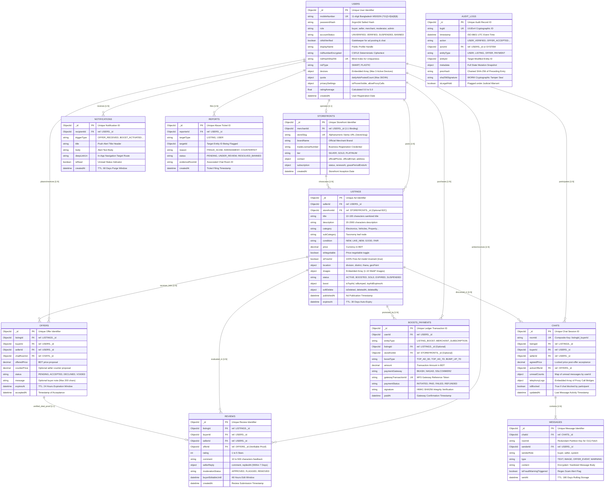

# Entity Relationship Diagram (ERD) Specification (`erd.md`)
## Next-Gen Verified C2C & B2C Marketplace Platform (Bangladesh)

| Document Attribute | Specification |
| :--- | :--- |
| **Document Version** | 1.0.0 (Master Relational & Schema Blueprint) |
| **Database Architecture** | MongoDB Atlas (Enterprise Document Store with Sharded Clusters & CSFLE) |
| **Notation Standard** | Crow's Foot Notation (Mermaid `erDiagram`) + Relational Cardinality Mapping |
| **Primary References** | `PRD.md` (v1.1.0+), `architecture.md` (v2.0.0), `dfd.md` (v1.0.1), `database.md` (v2.0.0) |
| **Target Data Model** | Hybrid Embedded/Referenced Document Paradigm optimized for sub-150ms drilldown reads |

---

## 1. Executive Summary & Modeling Principles

While MongoDB is a non-relational document database, enterprise systems operating at national scale (millions of classifieds, real-time negotiation streams, and legally binding transactions) require rigorous relational modeling to prevent data anomalies, avoid unbounded document growth (16MB BSON limit), and enforce multi-document consistency.

### Core Architectural Modeling Principles
1. **Bounded Growth ➔ Embed:** Subdocuments with strictly bounded array lengths (such as maximum 3 device bindings per user, maximum 10 images per listing, and current boost state) are embedded directly inside parent documents. This guarantees single-roundtrip $O(1)$ reads without relational `$lookup` overhead.
2. **Unbounded Streams ➔ Reference:** High-velocity, growing event streams (such as real-time chat messages, competitive buyer offers, and user reviews) are stored in dedicated collections with indexed foreign key references.
3. **Audit Immutability (WORM):** The `audit_logs` collection is modeled as an append-only, write-once ledger cryptographically chained using SHA-256 signatures. It references domain entity IDs (`actorId`, `entityId`) without hard cascade deletes.
4. **Data Isolation for Security (CSFLE):** Highly sensitive identity data (Bangladesh Smart/Plastic NID numbers) use Client-Side Field Level Encryption (CSFLE) with deterministic blind indexes for strict $1:1$ uniqueness checking.

---

## 2. Visual Entity Relationship Diagram (Mermaid)

The following diagram visualizes all 11 core collections, their cardinalities, primary keys (`PK`), foreign keys (`FK`), unique keys (`UK`), and relationship descriptors.



---

## 3. Relational Cardinality & Referential Integrity Matrix

The following table formally defines how entities interact across system boundaries, including foreign key paths, cardinality constraints, and on-delete lifecycle cascades:

| Source Entity | Target Entity | Cardinality | Foreign Key / Mapping Attribute | Relationship Semantics & Business Rules | On-Delete / State Cascade Behavior |
| :--- | :--- | :--- | :--- | :--- | :--- |
| **`users`** | **`listings`** | `1 : N` (Zero to Many) | `listings.sellerId ➔ users._id` | A user can post multiple free classified ads (max 30 per 24 hours). | When user is `BANNED`, all active listings cascade to `SUSPENDED`. |
| **`users`** | **`offers`** | `1 : N` (Zero to Many) | `offers.buyerId ➔ users._id`<br>`offers.sellerId ➔ users._id` | A user acts as buyer submitting proposals or seller receiving proposals. | If user banned, pending offers transition to `VOIDED`. |
| **`users`** | **`chats`** | `1 : N` (Zero to Many) | `chats.participants[] ➔ users._id` | Chat rooms have exactly 2 participant users (buyer and seller). | User soft-archive toggles `chats.isArchivedBy[]`. |
| **`users`** | **`reviews`** | `1 : N` (Zero to Many) | `reviews.buyerId ➔ users._id`<br>`reviews.sellerId ➔ users._id` | Dual-party feedback loop: verified buyer reviews seller; seller can reply once. | Reviews remain immutable; calculated into `users.stats.ratingAverage`. |
| **`users`** | **`storefronts`**| `1 : 1` (Zero or One) | `storefronts.merchantId ➔ users._id` | Strict $1:1$ binding; only verified merchants operate branded storefronts. | Storefront access suspended if merchant account is suspended. |
| **`users`** | **`boosts_payments`**| `1 : N` (Zero to Many) | `boosts_payments.userId ➔ users._id`| Audit log of voluntary boost purchases or merchant subscriptions. | Immutable financial records; retained 7 years for compliance. |
| **`users`** | **`notifications`**| `1 : N` (Zero to Many) | `notifications.recipientId ➔ users._id` | In-app alerts and push notifications delivered to specific account. | Auto-purged after 60 days via MongoDB TTL index. |
| **`users`** | **`reports`** | `1 : N` (Zero to Many) | `reports.reporterId ➔ users._id` | Formal fraud/abuse complaint filed by a registered user. | Preserved in moderation queue for staff resolution. |
| **`listings`**| **`offers`** | `1 : N` (Zero to Many) | `offers.listingId ➔ listings._id` | Multiple buyers can submit offers on an active listing. | When 1 offer is `ACCEPTED`, all competing offers cascade to `VOIDED`. |
| **`listings`**| **`chats`** | `1 : N` (Zero to Many) | `chats.listingId ➔ listings._id` | Each distinct buyer creates a separate chat room with the seller for an item. | Locked if listing is deleted or marked `SOLD`. |
| **`listings`**| **`reviews`** | `1 : N` (Zero or One) | `reviews.listingId ➔ listings._id` | Exactly 1 review permitted per sold listing transaction. | Unique index on `{ listingId: 1, buyerId: 1 }` prevents duplicates. |
| **`listings`**| **`boosts_payments`**| `1 : N` (Zero to Many) | `boosts_payments.listingId ➔ listings._id`| Promotes listing to Top Ad or Bump Up. | On confirmation, updates `listings.boost.isTopAd = true`. |
| **`storefronts`**| **`listings`**| `1 : N` (Zero to Many) | `listings.storefrontId ➔ storefronts._id` | Commercial merchants aggregate their inventory under their branded store. | If merchant subscription lapses, items revert to standard free ads. |
| **`chats`** | **`messages`** | `1 : N` (One to Many) | `messages.chatId ➔ chats._id` | Messages are partitioned by room for rapid chronological streaming. | 180-Day TTL rolling retention on messages collection. |
| **`offers`** | **`reviews`** | `1 : 1` (Zero or One) | `reviews.offerId ➔ offers._id` | A review requires a verified accepted offer as cryptographic proof of purchase. | Review form blocked unless target offer status is `ACCEPTED`. |

---

## 4. Embedding vs. Referencing Rationale Matrix

MongoDB schemas must balance performance (avoiding expensive `$lookup` joins) against document size constraints (16MB BSON ceiling).

| Schema Element | Target Placement | Strategy | Justification & Architectural Trade-off |
| :--- | :--- | :--- | :--- |
| `devices[]` | `users.devices` | **Embedded** | **Strictly Bounded (Max 3 Devices):** Device array contains 1 to 3 objects ($O(1)$ size). Embedding eliminates an extra database roundtrip on every authenticated API request. |
| `quota` | `users.quota` | **Embedded** | **High-Frequency Read/Write:** Daily free ad counter (max 30) is updated synchronously during ad posting. Embedding ensures atomic `$inc` updates without multi-table locks. |
| `images[]` | `listings.images`| **Embedded** | **Strictly Bounded (1 to 10 Images):** Ad images are always rendered together on product cards and details views. Maximum 10 image URLs/hashes consume less than 2KB of storage. |
| `boost` | `listings.boost` | **Embedded** | **Compound Index Optimization:** Querying Top Ads requires sorting by `{ "boost.isTopAd": -1, publishedAt: -1 }`. Embedding boost status allows single-index query coverage. |
| `messages` | `messages` (Collection) | **Referenced** | **Unbounded Volume:** An active buyer-seller negotiation can exchange hundreds of messages. Embedding in `chats` would risk hitting the 16MB document cap and bloat inbox fetches. |
| `offers` | `offers` (Collection) | **Referenced** | **ACID Transaction Isolation:** Multiple buyers can bid simultaneously. Isolated offer documents prevent document-level write contention during high-concurrency negotiations. |
| `reviews` | `reviews` (Collection) | **Referenced** | **Independent Moderation:** Reviews have distinct moderation states (`APPROVED`, `FLAGGED`), 48-hour buyer edit windows, and 7-day seller reply windows. |
| `audit_logs` | `audit_logs` (Collection) | **Referenced** | **WORM Compliance & Partitioning:** Compliance logs grow to tens of millions of records and must be append-only with SHA-256 chaining, partitioned independently from operational users. |

---

## 5. Domain Invariants & Referential Integrity Constraints

1. **Strict 1-to-1 NID Binding Invariant:**
   * A single verified Bangladesh NID cannot be linked to more than one active or banned account.
   * *Enforcement:* Unique sparse index on `users.kyc.nidHashSha256` (computed as `SHA-256(salt + rawNid)`).
2. **Single Active Offer Invariant:**
   * A buyer may only have at most one `PENDING` offer on a specific listing at any given moment.
   * *Enforcement:* Compound unique index on `{ listingId: 1, buyerId: 1, status: 1 }` where status equals `PENDING`.
3. **Atomic Offer Acceptance Invariant:**
   * When a seller accepts an offer, the listing's agreed price is locked, and all competing pending offers are atomically voided.
   * *Enforcement:* Multi-document ACID transaction using MongoDB `ClientSession` (`session.startTransaction()`).
4. **100% Free Ad Posting Model Invariant:**
   * Ad posting has no mandatory fee barrier. `listings.isFreeAd` is `true` by default. Boosts (`isTopAd`, `isBumped`) are strictly voluntary upsells.
   * *Enforcement:* Quota check `quota.dailyAdsPostedCount < 30` per 24 hours.
5. **Verified Transaction Review Proof Invariant:**
   * A buyer cannot submit a seller rating unless there exists a corresponding offer record with `status == "ACCEPTED"`.
   * *Enforcement:* Foreign key reference `reviews.offerId ➔ offers._id` with unique constraint `{ listingId: 1, buyerId: 1 }`.
6. **WORM Immutability Guard Invariant:**
   * Records inside `audit_logs` can never be edited or deleted by any user or administrator.
   * *Enforcement:* Database user permissions restricted to `insert` and `find` only; Mongoose middleware throws error on `updateOne` or `deleteOne`.

---

## 6. Primary & Foreign Key Indexing Summary

To guarantee sub-150ms drilldown and traversal across referenced entities, the following foreign key index definitions are deployed:

```javascript
// listings foreign keys
db.listings.createIndex({ sellerId: 1, createdAt: -1 });
db.listings.createIndex({ storefrontId: 1 }, { sparse: true });

// offers foreign keys
db.offers.createIndex({ listingId: 1, buyerId: 1, status: 1 });
db.offers.createIndex({ sellerId: 1, status: 1 });

// chats foreign keys
db.chats.createIndex({ roomId: 1 }, { unique: true });
db.chats.createIndex({ participants: 1, updatedAt: -1 });
db.chats.createIndex({ listingId: 1 });

// messages foreign keys
db.messages.createIndex({ chatId: 1, sentAt: -1 });
db.messages.createIndex({ roomId: 1, sentAt: -1 });

// reviews foreign keys
db.reviews.createIndex({ sellerId: 1, createdAt: -1 });
db.reviews.createIndex({ listingId: 1, buyerId: 1 }, { unique: true });
db.reviews.createIndex({ offerId: 1 }, { unique: true });

// storefronts foreign keys
db.storefronts.createIndex({ merchantId: 1 }, { unique: true });
db.storefronts.createIndex({ storeSlug: 1 }, { unique: true });

// boosts_payments foreign keys
db.boosts_payments.createIndex({ userId: 1, createdAt: -1 });
db.boosts_payments.createIndex({ listingId: 1, paymentStatus: 1 });
db.boosts_payments.createIndex({ gatewayTransactionId: 1 }, { unique: true, sparse: true });

// notifications foreign keys
db.notifications.createIndex({ recipientId: 1, isRead: 1, createdAt: -1 });

// reports foreign keys
db.reports.createIndex({ targetId: 1, status: 1 });
db.reports.createIndex({ reporterId: 1 });
```

---

*This document serves as the formal Entity Relationship Diagram specification for the Next-Gen Verified C2C & B2C Marketplace. All relationships, foreign keys, and invariants are synchronized with [PRD.md](file:///Volumes/Disk%20(%20G%20)/Buy%20Sell%20Software/PRD.md), [architecture.md](file:///Volumes/Disk%20(%20G%20)/Buy%20Sell%20Software/architecture.md), [dfd.md](file:///Volumes/Disk%20(%20G%20)/Buy%20Sell%20Software/dfd.md), [database.md](file:///Volumes/Disk%20(%20G%20)/Buy%20Sell%20Software/database.md), and [api-spec.md](file:///Volumes/Disk%20(%20G%20)/Buy%20Sell%20Software/api-spec.md).*
